# G.R.E.A.T. — Benutzerhandbuch

**Georg Radikal Einfacher Automatisierter TestcaseDesigner**

*Version 1.8.0 | Stand November 2026*

---

## Inhaltsverzeichnis

1. [Erste Schritte](#1-erste-schritte)
   - 1.1 Anmeldung
   - 1.2 Erststart & Standardpasswort
   - 1.3 Passwort wechseln
   - 1.4 Projektuebersicht
2. [Projekte verwalten](#2-projekte-verwalten)
   - 2.1 Projekt anlegen
   - 2.2 Projekt loeschen
   - 2.3 Datenbank zuruecksetzen
3. [Kategorien & Werte](#3-kategorien--werte)
   - 3.1 Kategorien anlegen
   - 3.2 Kategorien umbenennen & loeschen
   - 3.3 Kategorie-Typen (Normal, Ursache, Wirkung, Ergebnis)
   - 3.4 Werte verwalten
   - 3.5 Fehlerwerte markieren
   - 3.6 Default-Wert (Lineare Expansion)
   - 3.7 Risiko-Gewichtung
   - 3.8 Drag & Drop Sortierung
   - 3.9 BVA (Grenzwertanalyse)
4. [Entscheidungstabelle](#4-entscheidungstabelle)
   - 4.1 Ueberblick & Einstieg
   - 4.2 Ursache- und Wirkungskategorien
   - 4.3 Entscheidungstabelle-Ansicht
   - 4.4 Automatische Regelgenerierung
   - 4.5 Constraints (E, O, I, R, M)
   - 4.6 Constraint-Dialog
   - 4.7 Collapsing (automatische Reduktion)
   - 4.8 Don't Care (—)
   - 4.9 Extended Entry (multiple Werte pro Ursache)
   - 4.10 Wirkungen als Text
   - 4.11 Checksum-Validierung
   - 4.12 Widerspruchserkennung
   - 4.13 Vollstaendigkeitspruefung (Luecken)
   - 4.14 Cause-Effect-Graph
   - 4.15 Generierung aus Entscheidungstabelle
5. [Regeln (klassisch)](#5-regeln-klassisch)
   - 5.1 Regeltypen ueberblick
   - 5.2 Verbotene Kombinationen (Forbidden)
   - 5.3 Abhaengigkeiten (Dependency)
   - 5.4 Kombinieren (Combine)
   - 5.5 Regelvisualisierung
   - 5.6 Regelwidersprueche erkennen
6. [Testfall-Generierung](#6-testfall-generierung)
   - 6.1 Generierungsstrategien ueberblick
   - 6.2 All Combinations
   - 6.3 Pairwise / Orthogonal
   - 6.4 Each Choice
   - 6.5 Lineare Expansion
   - 6.6 T-Wise
   - 6.7 MC/DC
   - 6.8 Risk-Based
   - 6.9 Regeln bei Generierung anwenden
7. [Risikoabdeckung](#7-risikoabdeckung)
   - 7.1 Risikoabdeckung pro Testfall
   - 7.2 Risikoabdeckungs-Prozentsatz
   - 7.3 Risiko-Zusammenfassung
8. [Export](#8-export)
   - 8.1 CSV-Export
   - 8.2 JSON-Export
   - 8.3 Excel-Export
   - 8.4 Fehlerwert-Kennzeichnung im Export
9. [Datenklassen](#9-datenklassen)
   - 9.1 System-Datenklassen
   - 9.2 Eigene Datenklassen
   - 9.3 Datenklassen in Projekten verwenden
10. [Einstellungen](#10-einstellungen)
   - 10.1 Erscheinungsbild (Themes)
   - 10.2 Maximale Anzahl Testfaelle
   - 10.3 Datensicherung
11. [Benutzer & Rollen](#11-benutzer--rollen)
   - 11.1 Rollen: Admin, Editor, Viewer
   - 11.2 Projekt-Freigabe
   - 11.3 Benutzer verwalten
12. [Tastaturnavigation & Shortcuts](#12-tastaturnavigation--shortcuts)
13. [Glossar](#13-glossar)
14. [Haeufige Fragen (FAQ)](#14-haeufige-fragen-faq)

---

## 1. Erste Schritte

### 1.1 Anmeldung

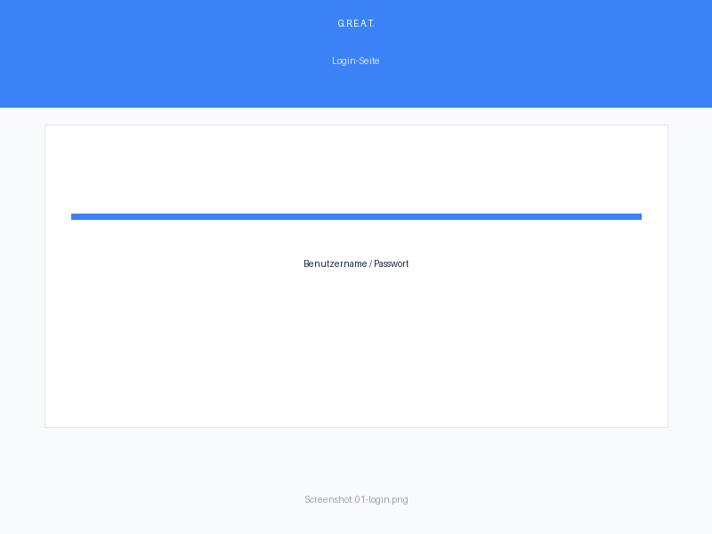

G.R.E.A.T. startet mit einer Login-Seite. Geben Sie Ihren Benutzernamen und Ihr Passwort ein.

| Feld | Beschreibung |
|------|-------------|
| **Benutzername** | Ihr vom Admin zugewiesener Benutzername |
| **Passwort** | Ihr persoenliches Passwort |

Bei falscher Eingabe erscheint eine Fehlermeldung. Nach drei fehlgeschlagenen Versuchen wird das Konto kurz gesperrt.

### 1.2 Erststart & Standardpasswort

Beim allerersten Start des Systems zeigt die Login-Seite das **Standardpasswort** des Admin-Accounts an. Dies ist ein bewusster Kompromiss aus Einfachheit und Sicherheit:

- Der Standard-Admin-Benutzer heisst `admin`
- Das Standardpasswort wird einmalig bei der Login-Seite angezeigt
- Nach der ersten Anmeldung sind Sie **verpflichtet**, das Passwort zu aendern (siehe 1.3)

> **Hinweis:** Kopieren Sie das Standardpasswort sofort in einen Passwort-Manager. Nach dem Verlassen der Login-Seite ist es nicht mehr einsehbar.

### 1.3 Passwort wechseln

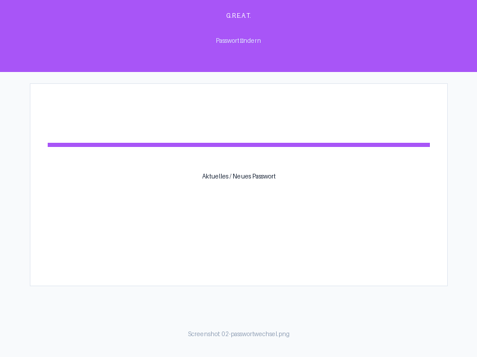

Nach der Erstanmeldung werden Sie automatisch zur Passwortwechsel-Seite weitergeleitet. Auch spaeter koennen Sie Ihr Passwort ueber die Top-Navigation unter **"Passwort aendern"** wechseln.

**Anforderungen an das neue Passwort:**

| Kriterium | Minimum |
|-----------|---------|
| Laenge | 12 Zeichen |
| Grossbuchstaben | mindestens 1 |
| Kleinbuchstaben | mindestens 1 |
| Ziffern | mindestens 1 |
| Sonderzeichen | mindestens 1 |

> **Warnung:** Das alte Standardpasswort kann nicht wieder als neues Passwort verwendet werden (`password_is_default`).

### 1.4 Projektuebersicht

Nach erfolgreicher Anmeldung gelangen Sie zur **Projektuebersicht**. Hier sehen Sie alle Projekte, auf die Sie Zugriff haben:

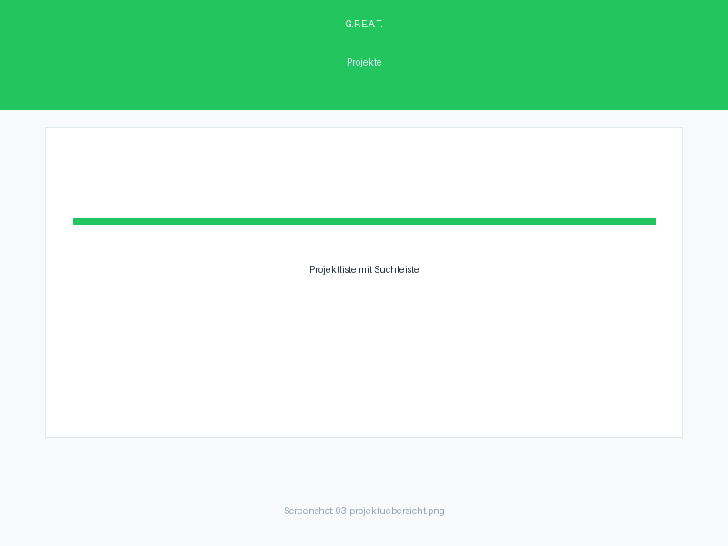

| Aktion | Beschreibung |
|--------|-------------|
| **Neues Projekt** | Legt ein neues, leeres Projekt an |
| **Projekt loeschen** | Entfernt ein Projekt unwiderruflich (mit Bestatigung) |
| **Bulk-Delete** | Loescht mehrere Projekte auf einmal |
| **Datenbank zuruecksetzen** | Stellt die Startkonfiguration wieder her (alle Daten gehen verloren) |

---

## 2. Projekte verwalten

### 2.1 Projekt anlegen

Klicken Sie auf **"Neues Projekt"** und geben Sie einen Namen ein. Das Projekt wird mit einer Beispielpopulierung gestartet (kann sofort bearbeitet werden).

### 2.2 Projekt loeschen

Rechtsklick auf ein Projekt im Projektbaum oeffnet das Kontextmenue mit der Option **"Loeschen"**. Eine Bestatigungsforderung verhindert versehentliche Loeschungen.

> **Achtung:** Alle Kategorien, Werte, Regeln und generierten Testfaelle des Projekts gehen unwiderruflich verloren.

### 2.3 Datenbank zuruecksetzen

In den **Einstellungen** finden Sie den Button **"Datenbank zuruecksetzen"**. Dies loescht alle Projekte, Benutzer (außer dem Admin) und stellt die Startkonfiguration wieder her.

> **Warnung:** Diese Aktion ist unwiderruflich. Sichern Sie wichtige Daten vorher (siehe 9.3).

---

## 3. Kategorien & Werte

Kategorien sind die Grundbausteine eines Testprojekts. Jede Kategorie entspricht einem Testparameter (z. B. "Betriebssystem", "Browser", "Datenbank").

### 3.1 Kategorien anlegen

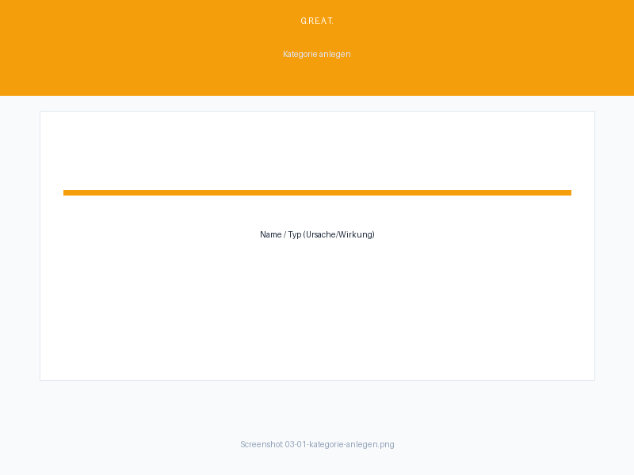

1. Oeffnen Sie ein Projekt
2. Im linken Bereich (Kategoriebaum) erscheint ein Eingabefeld **"Neue Kategorie"**
3. Geben Sie den Namen ein und drücken Sie Enter
4. Die Kategorie erscheint im Baum

**Kategorie-Typen bei der Anlage:**

| Typ | Bedeutung | Symbol |
|-----|-----------|--------|
| **Normal** | Standard-Kategorie | — |
| **Ursache** | Ursache in Ursache-Wirkung-Diagrammen | U |
| **Wirkung** | Wirkung in Ursache-Wirkung-Diagrammen | W |
| **Ergebnis** | Nicht an Generierung beteiligt, manuelle Eingabe | E |

### 3.2 Kategorien umbenennen & loeschen

| Aktion | Wie |
|--------|-----|
| **Umbenennen** | Rechtsklick → "Umbenennen" oder **F2** auf ausgewaehlter Kategorie |
| **Loeschen** | Rechtsklick → "Loeschen" (mit Bestatigung) |
| **Typ aendern** | Rechtsklick → "Typ: Normal/Ursache/Wirkung" |

### 3.3 Kategorie-Typen im Detail

**Ergebnis-Kategorien (`is_result=True`):**
- Werden **nicht** bei der automatischen Testfall-Generierung beruecksichtigt
- Konnen nach der Generierung manuell in der Testfalltabelle befuellt werden
- Erkennbar am **E**-Badge im Kategoriebaum

### 3.4 Werte verwalten

Jede Kategorie kann beliebig viele Werte enthalten. Werte代表 die moeglichen Eingabewerte fuer einen Testparameter.

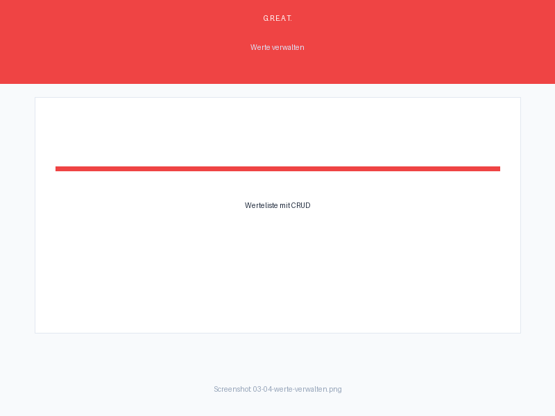

| Aktion | Wie |
|--------|-----|
| **Wert hinzufuegen** | Klick auf "+" neben der Kategorie |
| **Wert umbenennen** | Rechtsklick → "Umbenennen" oder **F2** |
| **Wert loeschen** | Rechtsklick → "Loeschen" |
| **Werte sortieren** | Drag & Drop im Wertelistenbereich |

**Werte-Zaehler:** Rechts neben jeder Kategorie zeigt ein Badge die Anzahl der Werte an. Ist die Kategorie noch nicht geoeffnet, erscheint "…" — ein Klick laedt die Werte.

### 3.5 Fehlerwerte markieren

Fehlerwerte (auch "Ungueltige Werte" genannt) sind Eingaben, die **nicht erlaubt** sind und die das System ablehnen soll. Sie sind wichtig fuer negative Tests.


**Markierung als Fehlerwert:**
1. Rechtsklick auf den Wert
2. **"Als Fehlerwert markieren"** anklicken
3. Der Wert wird mit einem **✕**-Symbol (rot) gekennzeichnet

**Verhalten bei Generierung:**
- Fehlerwerte werden in die Testfallgenerierung einbezogen
- Testfaelle mit Fehlerwerten werden **ans Ende der Liste** sortiert
- Im Export erscheint eine Spalte "Fehlerwert" (JA/NEIN)

### 3.6 Default-Wert (Lineare Expansion)

Die Strategie **"Lineare Expansion"** benoetigt pro Kategorie einen **Default-Wert**. Dieser Wert wird in allen Testfaellen verwendet, ausser in dem Testfall, der den aktuellen Wert testet.

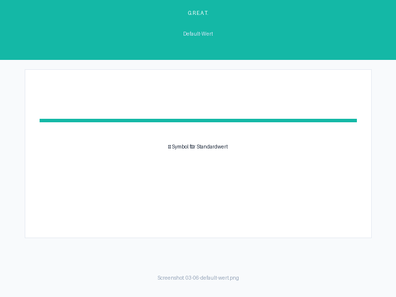

**Default-Wert setzen:**
1. Rechtsklick auf den Wert
2. **"★ Als Default markieren"** anklicken
3. Der Wert wird mit einem **★**-Symbol (gold) gekennzeichnet

**Default-Wert entfernen:**
1. Rechtsklick auf den Default-Wert
2. **"✕ Default entfernen"** anklicken

> **Wichtig:** Pro Kategorie kann nur **ein** Default-Wert existieren. Setzen Sie einen neuen Default, wird der alte automatisch entfernt.

**Symbolueberblick:**

| Symbol | Bedeutung | Farbe |
|--------|-----------|-------|
| ★ | Default-Wert (Lineare Expansion) | Gold/Amber |
| ✕ | Fehlerwert (nicht erlaubt) | Rot |
| R1–R10 | Risiko-Gewichtung | Orange |

### 3.7 Risiko-Gewichtung

Jeder Wert kann ein **Risiko-Gewicht** (1–10) erhalten. Hoehere Gewichte bedeuten hoeheres Risiko und werden bei risikobasierten Strategien priorisiert.

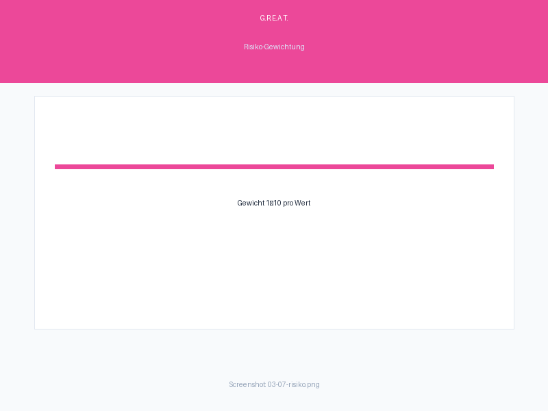

**Einstellung:**
- Im Wertelistenbereich erscheint ein kleines Eingabefeld (Default: 1)
- Rechtsklick auf den Wert → Risiko aendern
- Werte mit Risiko > 2 werden mit **R{n}**-Badge markiert

### 3.8 Drag & Drop Sortierung

Kategorien und Werte koennen per **Drag & Drop** sortiert werden:

- **Kategorien:** Ziehen Sie eine Kategorie im Baum nach oben/unten
- **Werte:** Ziehen Sie einen Wert in der Werteliste um

Die Sortierung bestimmt die Reihenfolge in generierten Testfaellen und Exporten.

### 3.9 BVA (Grenzwertanalyse)

**Boundary Value Analysis (BVA)** generiert automatisch Testwerte an den Grenzen von Wertebereichen. Sie ist direkt in der Kategorieverwaltung integriert.

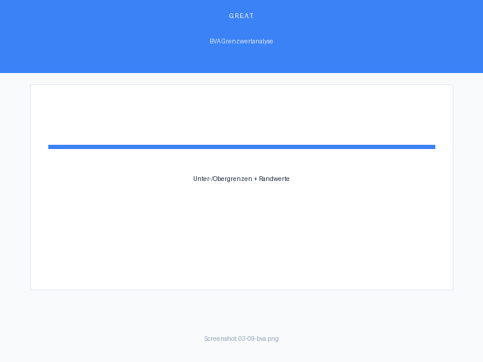

**Einstieg:**
1. Rechtsklick auf eine Kategorie oder Klick auf das **BVA-Symbol** (↗↘) neben der Kategorie
2. Der BVA-Dialog oeffnet sich

**Einfache BVA (ein Bereich):**
| Feld | Beschreibung |
|------|-------------|
| **Minimum** | Untere Grenze des erlaubten Bereichs |
| **Maximum** | Obere Grenze des erlaubten Bereichs |
| **Punkte pro Grenze** | 2, 3 oder 4 Werte pro Grenze |

**Punkte pro Grenze:**
| Punkte | Generierte Werte pro Grenze |
|--------|----------------------------|
| 2 | Grenze, Grenze+1 |
| 3 | Grenze-1, Grenze, Grenze+1 |
| 4 | Grenze-2, Grenze-1, Grenze, Grenze+1 |

**Beispiel (Minimum=10, Maximum=100, 3 Punkte):**
| Position | Wert | Typ |
|----------|-----|-----|
| Unterhalb | 9 | Fehlerwert (✕) |
| Untere Grenze | 10 | Gueltig |
| Innerhalb | 11 | Gueltig |
| Innerhalb | 99 | Gueltig |
| Obere Grenze | 100 | Gueltig |
| Oberhalb | 101 | Fehlerwert (✕) |

**Multi-Range BVA (mehrere Bereiche):**
Fuer komplexe Szenarien mit mehreren erlaubten/verbotenen Bereichen:
1. Im BVA-Dialog auf **"Mehrere Bereiche"** umschalten
2. Pro Bereich Minimum, Maximum und erlaubten/verbotenen Status definieren
3. BVA generiert Werte an allen Grenzen aller Bereiche

**Ergebnis:**
- Gueltige Werte werden als normale Werte angelegt
- Ungueltige Werte (außerhalb der Bereiche) werden automatisch als **Fehlerwerte** (✕) markiert
- Die Werte erscheinen in der Kategorie und koennen sofort fuer die Generierung verwendet werden

---

## 4. Entscheidungstabelle

Die **Entscheidungstabelle** (Cause-Effect-Table) ist eine systematische Testdesign-Technik nach ISTQB. Sie modelliert die logischen Zusammenhaenge zwischen **Ursachen** (Eingaben) und **Wirkungen** (Ergebnisse) und generiert daraus minimale, vollstaendige Testsaetze.

### 4.1 Ueberblick & Einstieg

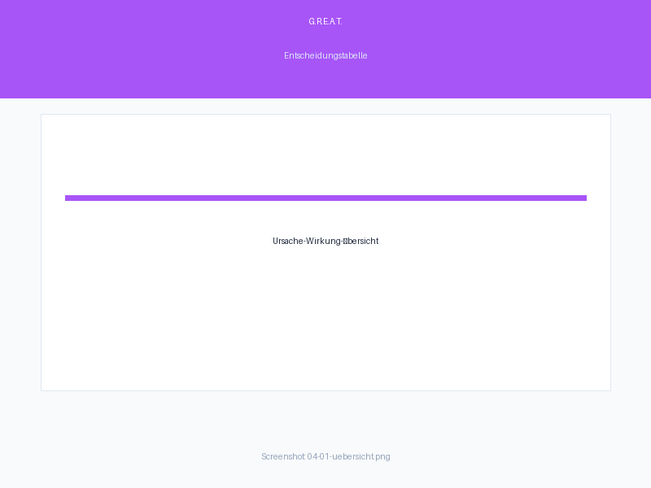

**Einstieg:**
1. Oeffnen Sie ein Projekt
2. Klicken Sie auf den **"Entscheidungstabelle"** Button im Bereich "Kategorien & Werte"
3. Die Entscheidungstabelle-Ansicht oeffnet sich in einem neuen Karteireiter

**Wichtige Regel:**
- Sobald die Entscheidungstabelle aktiv ist, werden die klassischen Kombinatorik-Strategien (All Combinations, Pairwise, etc.) **ausgegraut**
- Die Generierung erfolgt ausschliesslich ueber die Entscheidungstabelle

### 4.2 Ursache- und Wirkungskategorien

Die Entscheidungstabelle unterscheidet zwei Kategorie-Typen:

| Typ | Symbol | Rolle | Position in Tabelle |
|-----|--------|-------|---------------------|
| **Ursache** | U | Eingabe/Condition | Obere Halfte der Tabelle |
| **Wirkung** | W | Ergebnis/Effect | Untere Halfte der Tabelle |

**Kategorie-Typ zuweisen:**
1. Rechtsklick auf Kategorie im Baum
2. **"Typ: Ursache"** oder **"Typ: Wirkung"** auswahlen
3. Der Typ wird durch das entsprechende Badge (U/W) im Baum angezeigt

**Anforderungen:**
- Mindestens **eine Ursache** und **eine Wirkung** ist erforderlich
- Normal-Kategorien und Ergebnis-Kategorien werden in der Entscheidungstabelle nicht verwendet
- Der Typ kann jederzeit nachtraeglich geaendert werden

### 4.3 Entscheidungstabelle-Ansicht

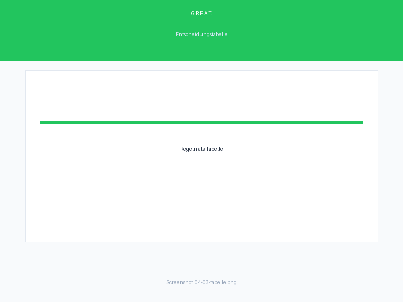

Die Tabelle besteht aus drei Bereichen:

**Obere Halfte — Ursachen (Conditions):**
| Spalte | Bedeutung |
|--------|-----------|
| Ursache-Name | Kategoriename der Ursache |
| Ja/Nein/— | Wertzuordnung fuer diese Regel (Spalte) |

**Trennlinie:** Visuelle Trennung zwischen Ursachen und Wirkungen

**Untere Halfte — Wirkungen (Effects):**
| Spalte | Bedeutung |
|--------|-----------|
| Wirkung-Name | Kategoriename der Wirkung |
| Ja/Nein/Text/— | Ergebnis fuer diese Regel (Spalte) |

**Rechte Spalte — Constraints:**
- Constraints pro Ursache (E, O, I, R, M, siehe 4.5)

**Jede vertikale Spalte** repraesentiert eine **Regel** (ein Testfall).

### 4.4 Automatische Regelgenerierung

Bei Aktivierung der Entscheidungstabelle generiert G.R.E.A.T. **automatisch** alle gueltigen Kombinationen der Ursachen:

- Bei 2 Ursachen: 2 × 2 = **4 Regeln** (Ja/Ja, Ja/Nein, Nein/Ja, Nein/Nein)
- Bei 3 Ursachen: 2 × 2 × 2 = **8 Regeln**
- Bei n Ursachen: **2^n Regeln**

**Ablauf:**
1. Tabelle wird mit allen Ursache-Kombinationen befuellt
2. Wirkungen sind initial leer (—)
3. Sie fueullen die Wirkungen manuell oder halb-automatisch
4. G.R.E.A.T. wendet automatisch **Collapsing** an (siehe 4.7)

> **Hinweis:** Die Anzahl der Regeln wird durch die Maximale-Testfaelle-Einstellung begrenzt (Default 1000).

### 4.5 Constraints (E, O, I, R, M)

**Constraints** (Einschraenkungen) definieren logische Zusammenhaenge zwischen Ursachen. Sie reduzieren die Anzahl der gueltigen Kombinationen und damit der Testfaelle.

| Constraint | Abkuerzung | Bedeutung | Beispiel |
|------------|-----------|-----------|----------|
| **Exclusive** | E | Maximal eine Ursache kann "Ja" sein | Nur ein Format kann ausgewaehlt sein |
| **One-and-Only-One** | O | Genau eine Ursache muss "Ja" sein | Genau eine Zahlungsart muss gewaehlt werden |
| **Inclusive** | I | Mindestens eine Ursache muss "Ja" sein | Mindestens eine Kontaktmoeglichkeit muss angegeben werden |
| **Requires** | R | Wenn A="Ja", dann B="Ja" | Wenn "Premium", dann "Login erforderlich" |
| **Mask** | M | Wenn A="Ja", dann B="Nein" | Wenn "Gratis", dann "Premium=Nein" |

**Anwendung:**
- Constraints werden pro Ursache definiert
- Mehrere Ursachen koennen zum gleichen Constraint gehoeren (Gruppe)
- Bei Regelgenerierung werden ungueltige Kombinationen automatisch entfernt

### 4.6 Constraint-Dialog

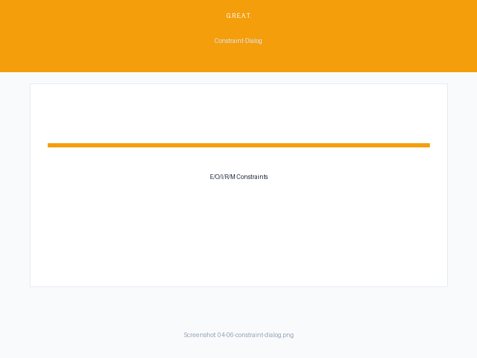

**Oeffnen:**
1. Rechtsklick auf eine Ursache in der Tabelle
2. **"Constraint setzen"** auswahlen
3. Constraint-Dialog oeffnet sich

**Im Dialog:**
1. **Constraint-Typ** auswahlen (E, O, I, R, M)
2. **Betroffene Ursachen** markieren (mehrere auswahlbar)
3. Bei **Requires (R)**: Ursache A (Trigger) und Ursache B (Anforderung) zuordnen
4. Bei **Mask (M)**: Ursache A (Trigger) und Ursache B (Blockierung) zuordnen
5. **"Anwenden"** → Constraint wird gespeichert und in der Tabelle angezeigt

**Anzeige in der Tabelle:**
- Constraints erscheinen als Badge neben der Ursache (z. B. "E" in rot)
- Hover ueber Badge zeigt Details (beteiligte Ursachen)

### 4.7 Collapsing (automatische Reduktion)

**Collapsing** reduziert die Anzahl der Regeln, indem Regeln mit identischem Wirkungsverhalten zusammengefasst werden.

**Prinzip:**
- Wenn zwei Regeln dieselben Wirkungen haben, werden sie zu einer Regel zusammengefasst
- Die Ursache, die in beiden Regeln unterschiedlich ist, wird zu **"—" (Don't Care)**

**Beispiel (vor Collapsing):**

| | Regel 1 | Regel 2 |
|---|---------|---------|
| Ursache A | Ja | Nein |
| Ursache B | Ja | Ja |
| Wirkung X | Ja | Ja |

**Nach Collapsing:**

| | Regel 1+2 |
|---|---------|
| Ursache A | — (Don't Care) |
| Ursache B | Ja |
| Wirkung X | Ja |

**Ergebnis:**
- Die Anzahl der Regeln (Testfaelle) wird reduziert
- Die Vollstaendigkeit bleibt gewaehrleistet
- Collapsing wird automatisch nach jeder Aenderung angewendet

### 4.8 Don't Care (—)

**"—" (Don't Care / Irrelevant)** bedeutet: "Der Wert dieser Ursache ist fuer diese Regel unerheblich."

**Entsteht durch:**
- Collapsing (automatisch, siehe 4.7)
- Manuelle Eingabe (Rechtsklick auf Zelle → "Don't Care setzen")

**Bei der Generierung:**
- Don't Care bedeutet: "Beide Werte (Ja und Nein) sind moeglich"
- Daraus werden **zwei Testfaelle** generiert (einer mit Ja, einer mit Nein)
- Dies gewaehrleistet, dass keine Kombination uebersehen wird

**Beispiel:**
| Ursache A | Ursache B | Wirkung |
|-----------|-----------|---------|
| — | Ja | X=Ja |

→ Generiert: (A=Ja, B=Ja → X=Ja) **und** (A=Nein, B=Ja → X=Ja)

### 4.9 Extended Entry (multiple Werte pro Ursache)

Klassische Entscheidungstabellen verwenden nur **Ja/Nein** (binar). G.R.E.A.T. unterstuetzt **Extended Entry**: multiple Werte pro Ursache in einer Regel.

**Anwendung:**
- Rechtsklick auf Zelle → Wert aus der Werteliste auswahlen
- Nicht auf Ja/Nein beschrankt — alle Werte der Kategorie sind verwendbar

**Vorteil:**
- Realistischere Modellierung (nicht alles ist binar)
- Weniger Regeln bei komplexen Szenarien

**Beispiel:**
| Browser | OS | Wirkung |
|---------|-----|---------|
| Chrome | Windows | Kompatibel |
| Firefox | Linux | Kompatibel |
| IE | — | Inkompatibel |

### 4.10 Wirkungen als Text

Neben binaren Wirkungen (Ja/Nein) koennen Wirkungen als **freier Text** definiert werden.

**Einstellung:**
- Rechtsklick auf Wirkungskategorie → **"Wirkungen als Text"** aktivieren
- Ab jetzt koennen in der Tabelle beliebige Textwerte eingetragen werden

**Beispiel:**
| Ursache: Login | Wirkung: Nachricht |
|---------------|-------------------|
| Ja | "Willkommen" |
| Nein | "Bitte melden Sie sich an" |

**Vorteil:**
- Direkt die erwarteten Testergebnisse als Text
- Bessere Nachvollziehbarkeit der Testfaelle

### 4.11 Checksum-Validierung

Die **Checksum-Validierung** prueft, ob die Tabelle konsistent ist:

**Pruefung:**
- Jede Regel hat eine eindeutige Kombination von Ursache-Werten
- Keine zwei Regeln haben identische Ursache-Werte (Duplikat)
- Alle Wirkungen sind fuer jede Regel definiert (oder explizit Don't Care)

**Anzeige:**
- **Gruen:** Tabelle ist konsistent ✓
- **Rot:** Widerspruch oder Luecke erkannt ✕
- Hover zeigt Details zur Fehlermeldung

**Aktivierung:**
- In der Tabelle-Toolbar auf **"Checksum pruefen"** klicken

### 4.12 Widerspruchserkennung

G.R.E.A.T. erkennt automatisch **Widersprueche** in der Entscheidungstabelle:

| Typ | Beschreibung | Beispiel |
|-----|-------------|----------|
| **Duplikat** | Zwei Regeln mit gleichen Ursachen | Regel 1 und 3 haben beide A=Ja, B=Ja |
| **Konflikt** | Gleiche Ursachen, unterschiedliche Wirkungen | Regel 1: A=Ja → X=Ja; Regel 2: A=Ja → X=Nein |
| **Unmoeglich** | Constraint wird verletzt | E-Constraint, aber zwei Ursachen sind "Ja" |

**Anzeige:**
- Betroffene Zellen/Regeln werden **rot markiert**
- Toast-Nachricht mit Beschreibung des Widerspruchs
- **"Widersprueche anzeigen"** Button in der Toolbar

### 4.13 Vollstaendigkeitspruefung (Luecken)

Die **Vollstaendigkeitspruefung** identifiziert **fehlende Kombinationen** der Ursachen:

**Prinzip:**
- Alle moeglichen Ursache-Kombinationen werden mit der Tabelle verglichen
- Fehlende Kombinationen werden als **Luecken** markiert

**Anzeige:**
- **Vollstaendig:** Alle Kombinationen abgedeckt ✓
- **Luecken:** n Kombinationen nicht abgedeckt (Details aufklappbar)

**Beispiel:**
- 2 Ursachen (A, B) → 4 moegliche Kombinationen
- Tabelle hat nur 3 Regeln → 1 Luecke
- Luecke: "A=Nein, B=Nein" ist nicht in der Tabelle

**Aktion:**
- **"Luecken auffuellen"** → fehlende Regeln werden automatisch hinzugefuegt
- Oder manuell: neue Regel mit den fehlenden Werten hinzufuegen

### 4.14 Cause-Effect-Graph

Der **Cause-Effect-Graph** visualisiert die logischen Zusammenhaenge zwischen Ursachen, Constraints und Wirkungen als Graph/Diagramm.

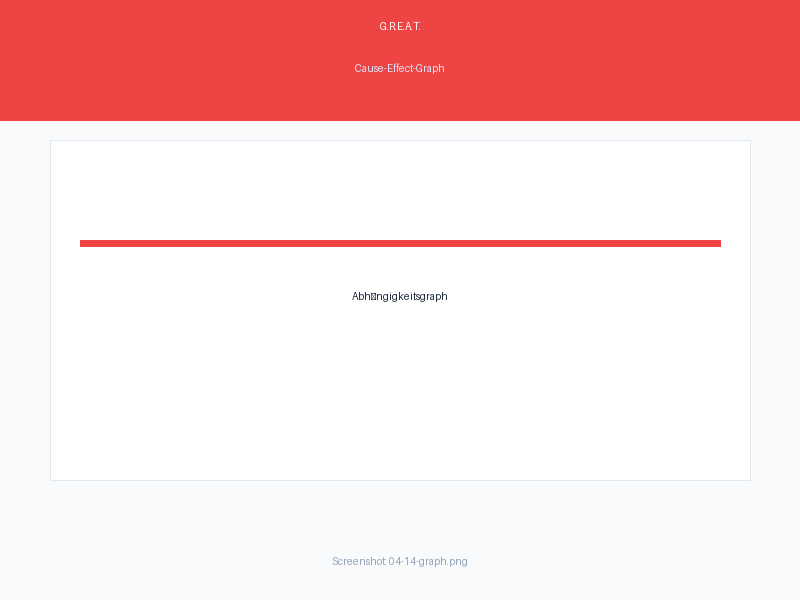

**Elemente:**
| Symbol | Bedeutung |
|--------|-----------|
| Rechteck | Ursache oder Wirkung |
| Pfeil | Logische Abhaengigkeit |
| AND/OR/NOT | Logische Operatoren |
| Constraint-Symbole | E, O, I, R, M |

**Navigation:**
- **Zoom:** Mausrad
- **Verschieben:** Klick und Ziehen
- **Details:** Hover ueber Knoten zeigt Beschreibung

**Aktivierung:**
- In der Tabelle-Toolbar auf **"Graph anzeigen"** klicken
- Graph oeffnet sich in separater Ansicht neben der Tabelle

### 4.15 Generierung aus Entscheidungstabelle

Nachdem die Tabellevollstaendig und widerspruchsfrei ist, koennen Testfaelle generiert werden:

**Ablauf:**
1. Auf **"Generieren"** Button klicken
2. G.R.E.A.T. erzeugt pro Regel einen oder mehrere Testfaelle:
   - Don't Care (—) → zwei Testfaelle (Ja und Nein)
   - Extended Entry → ein Testfall pro Wertkombination
3. Testfaelle werden in der Generierungsansicht angezeigt
4. Export wie ueblich (CSV, JSON, Excel)

**Besonderheiten:**
- Constraints werden bei der Generierung beruecksichtigt
- Widersprueche blockieren die Generierung (zuerst beheben)
- Luecken koennen zur Generierung gefuehrt haben (Warnung)

**Ergebnis:**
- Minimaler, vollstaendiger Testsatz
- Jede Regel ist abgedeckt
- Constraints sind gewaehrleistet

---

## 5. Regeln (klassisch)

Regeln definieren Zusammenhaenge zwischen Werten verschiedener Kategorien. Sie reduzieren den Testraum auf relevante Kombinationen.

### 5.1 Regeltypen ueberblick

| Typ | Symbol | Bedeutung | Farbe |
|-----|--------|-----------|-------|
| **Verboten** (Forbidden) | ✕ | Wenn A=X, dann B!=Y | Rot |
| **Abhaengig** (Dependency) | → | Wenn A=X, dann B=Y | Violett |
| **Kombinieren** (Combine) | ⊂ | Wenn A=X, dann B in [Y,Z,...] | Gruen |

### 5.2 Verbotene Kombinationen (Forbidden)

Eine verbotene Kombination sagt: "Wenn Kategorie A den Wert X hat, darf Kategorie B **nicht** den Wert Y haben."

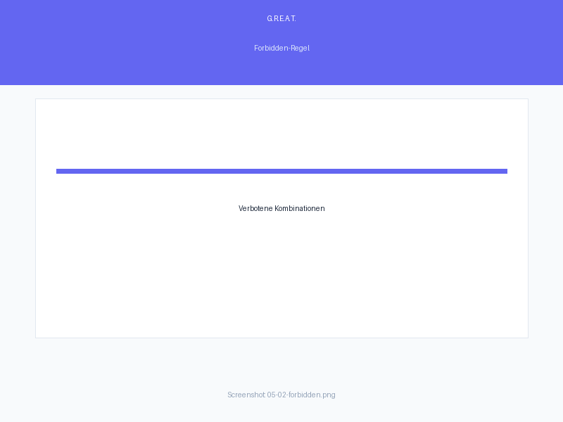

**Beispiel:**
- Wenn **Browser = Internet Explorer**, dann **CSS-Feature != Grid Layout**
- Diese Kombination wird bei der Generierung automatisch ausgeschlossen

**Anlegen:**
1. Im Regelbereich auf **"Verbotene Regel"** klicken
2. Wenn-Kategorie und Wenn-Wert auswahlen
3. Dann-Kategorie und Dann-Wert auswahlen
4. Regel wird sofort gespeichert

### 5.3 Abhaengigkeiten (Dependency)

Eine Abhaengigkeit sagt: "Wenn Kategorie A den Wert X hat, **muss** Kategorie B den Wert Y haben."

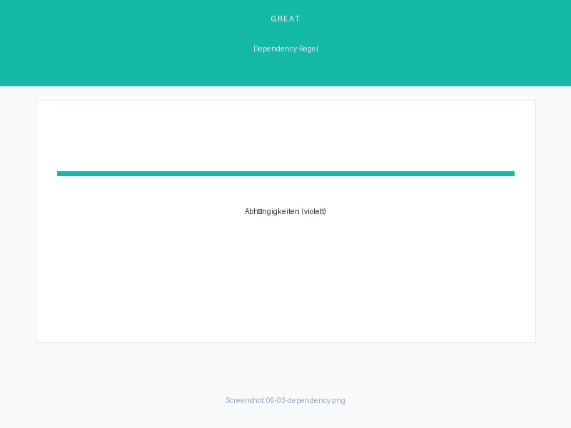

**Beispiel:**
- Wenn **Datenbank = Oracle**, dann **Treiber = JDBC**
- Diese Kombination wird erzwungen

### 5.4 Kombinieren (Combine)

Eine Combine-Regel sagt: "Wenn Kategorie A den Wert X hat, darf Kategorie B **nur** einen der Werte aus der Liste [Y, Z, ...] haben."


**Beispiel:**
- Wenn **Betriebssystem = Linux**, dann **Webserver in [Apache, Nginx]**
- Andere Webserver (IIS, Tomcat) werden fuer Linux ausgeschlossen

### 5.5 Regelvisualisierung

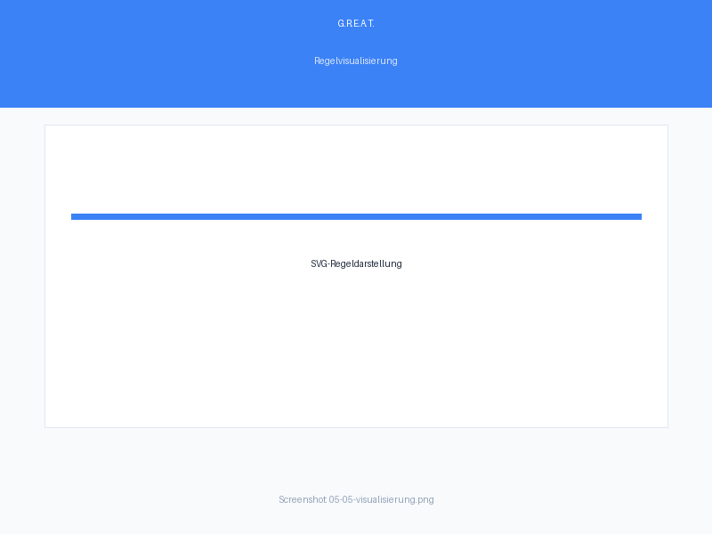

G.R.E.A.T. zeigt Regeln als **SVG-basierte Verbindungslinien** zwischen den Werten verschiedener Kategorien:

| Regeltyp | Linienstil | Farbe |
|----------|-----------|-------|
| Verboten | Gestrichelt + ✕ | Rot |
| Abhaengig | Durchgehend + → | Violett |
| Kombinieren | Punktiert + ⊂ | Gruen |

**Interaktion:**
- **Hover:** Mauszeiger ueber Linie zeigt Tooltip mit Regeldetails
- **Refresh:** ↻-Button aktualisiert die Visualisierung
- **Hoehe anpassen:** Resize-Handle zum Vergrößern/Verkleinern

### 5.6 Regelwidersprueche erkennen

G.R.E.A.T. prueft automatisch auf Widersprueche zwischen Regeln:

- **Duplikate:** Gleiche Regel existiert bereits
- **Widersprueche:** Zwei Regeln erzwingen gegensatzliche Werte
- **Tote Werte:** Ein Wert kann durch Regeln nie in einem Testfall erscheinen

Warnungen erscheinen als Toast-Nachrichten bei Regelanlage.

---

## 6. Testfall-Generierung

### 6.1 Generierungsstrategien ueberblick

| Strategie | Abkuerzung | Beschreibung | Wann verwenden |
|-----------|-----------|-------------|----------------|
| **All Combinations** | All | Vollstaendige kartesische Produkt | Kleine Projekte, Referenz |
| **Pairwise** | Pair | Jede Wertepaar-Kombination mindestens einmal | Standard, guter Coverage/Aufwand |
| **Orthogonal** | Orth | Orthogonale Arrays | Gleichverteilte Kategorien |
| **Each Choice** | Each | Jeder Wert mindestens einmal | Minimaler Testsatz |
| **Lineare Expansion** | Linear | Pro Kategorie ein Test, Rest auf Default | Geringer Aufwand |
| **T-Wise** | T-Wise | T-weise Kombinationen (t=2–5) | Konfigurierbare Tiefe |
| **MC/DC** | MC/DC | Modified Condition/Decision Coverage | Sicherheitskritisch (DO-178C) |
| **Risk-Based** | Risk | Risikogewichtete Auswahl | Risikofokus |
| **BVA** | BVA | Boundary Value Analysis | Numerische Bereiche |

### 6.2 All Combinations

Generiert **alle moeglichen Kombinationen** aller Werte aller Kategorien.

**Formel:** `Anzahl Testfaelle = W1 × W2 × ... × Wn` (W = Werte pro Kategorie)

**Beispiel:** 3 Kategorien mit je 3 Werten → 3 × 3 × 3 = **27 Testfaelle**

> **Achtung:** Bei vielen Kategorien/Werten explodiert die Anzahl schnell. Standardlimit: 1000 Testfaelle pro Generierung.

**Eigenschaften:**
- 100%ige kombinatorische Abdeckung
- Theoretisches Maximum fuer Risikoabdeckung
- Gut als Referenz fuer andere Strategien

### 6.3 Pairwise / Orthogonal

**Pairwise (All Pairs):** Testet jede **Paar-Kombination** von Werten mindestens einmal. Bei 3 Kategorien mit je 3 Werten: statt 27 nur ca. 9 Testfaelle.

**Orthogonal:** Basiert auf **orthogonalen Arrays** (Sroka/Meyer-Algorithmus). Liefert minimale Testsaetze mit garantierter Paar-Abdeckung.

**Wann verwenden:**
- Paarweise Fehler sind am haeufigsten (Studien: 95%+ der Fehler entstehen durch Interaktionen von 1–2 Parametern)
- Gutes Verhaeltnis von Abdeckung zu Aufwand

### 6.4 Each Choice

Stellt sicher, dass **jeder Wert** in mindestens einem Testfall vorkommt. Liefert den **minimal moeglichen** Testsatz.

**Beispiel:** 3 Kategorien mit 3, 4, 2 Werten → mindestens 4 Testfaelle (determiniert durch die groesste Kategorie)

**Wann verwenden:**
- Schneller Ueberblick
- Sehr grosse Testraeme
- Kombination mit anderen Strategien

### 6.5 Lineare Expansion

Pro Kategorie wird **ein Testfall** erzeugt, in dem der Wert der aktuellen Kategorie variiert und alle anderen Kategorien ihren **Default-Wert** haben.

**Voraussetzung:** Jede Kategorie braucht genau einen **Default-Wert** (markiert mit ★).

**Beispiel:** 3 Kategorien → 3 Testfaelle

**Wann verwenden:**
- Minimaler Testaufwand
- Smoke Tests
- Schnelle Regression

### 6.6 T-Wise

Verallgemeinerung von Pairwise: Testet alle **T-fachen Kombinationen**. Standard: t=2 (identisch mit Pairwise). Konfigurierbar bis t=5.

**Formel:** Hoeheres t → bessere Abdeckung, aber exponentiell mehr Testfaelle

**Einstellung:** In der Generierungs-UI waehlen Sie die T-Staerke (2–5).

### 6.7 MC/DC

**Modified Condition/Decision Coverage** ist ein Testkriterium aus der Luft- und Raumfahrt (DO-178C). Es stellt sicher, dass jede Bedingung in einer booleschen Formel unabhaengig von den anderen Bedingungen den Ausgang beeinflusst.

**Wann verwenden:**
- Sicherheitskritische Software (Avionics, Medizintechnik, Automotive)
- Zertifizierungsanforderungen (DO-178C, ISO 26262)

### 6.8 Risk-Based

Generiert Testfaelle basierend auf den **Risiko-Gewichten** der Werte. Hoeher gewichtete Werte erscheinen haeufiger.

**Voraussetzung:** Werte sollten Risiko-Gewichte (1–10) haben. Default-Gewicht: 1.

**Wann verwenden:**
- Fokus auf hochriskante Bereiche
- Begrenter Testzeitrahmen

### 6.9 Regeln bei Generierung anwenden

In der Generierungs-UI finden Sie die Option **"Regeln anwenden"** (Checkbox). Wenn aktiviert:

1. Die Regel-Engine wird vor der Generierung geladen
2. Generate Testfaelle werden nach Regeln gefiltert
3. Verbotene Kombinationen werden entfernt
4. Abhaengigkeiten werden erzwungen
5. Combine-Regeln beschraenken erlaubte Werte

> **Hinweis:** Regeln koennen die Anzahl der generierten Testfaelle deutlich reduzieren.

---

## 7. Risikoabdeckung

### 7.1 Risikoabdeckung pro Testfall

Jeder Testfall erhaelt einen **risk_coverage**-Wert: die **Summe der Risiko-Gewichte** aller zugewiesenen Werte.

**Beispiel:**
| Testfall | Browser (R3) | OS (R5) | DB (R2) | risk_coverage |
|----------|-------------|---------|---------|--------------|
| TC_1 | Chrome | Linux | MySQL | 3 + 5 + 2 = **10** |
| TC_2 | Firefox | Windows | Oracle | 3 + 1 + 5 = **9** |

Testfaelle werden **absteigend nach risk_coverage** sortiert (hohe Risiken zuerst). Testfaelle mit Fehlerwerten kommen trotzdem ans Ende.

### 7.2 Risikoabdeckungs-Prozentsatz

Der **risk_coverage_percent** gibt an, wie gross der Anteil der erfassten Risiken am theoretischen Maximum (All Combinations) ist:

```
Prozent = (Summe aller risk_coverage / Maximum bei All Combinations) × 100
```

| Strategie | Typischer Wert |
|-----------|---------------|
| All Combinations | 100% |
| Pairwise | 40–70% |
| Each Choice | 10–30% |
| Lineare Expansion | 5–15% |

> **Hinweis:** Ein niedriger Prozentsatz bedeutet nicht schlechte Qualität — er zeigt nur, dass weniger Kombinationen getestet werden. Pairwise deckt z. B. 95%+ der paarenweise Fehler ab bei nur 30–50% Risikoabdeckung.

### 7.3 Risiko-Zusammenfassung

Nach der Generierung zeigt G.R.E.A.T. eine **Risiko-Zusammenfassung**:

| Kennzahl | Bedeutung |
|----------|-----------|
| **total_risk** | Summe aller risk_coverage-Werte |
| **max_possible_risk** | Theoretisches Maximum (All Combinations) |
| **risk_coverage_percent** | Erreichter Anteil in % |
| **testcase_count** | Anzahl generierter Testfaelle |

---

## 8. Export

### 8.1 CSV-Export

Exportiert Testfaelle als CSV-Datei (semikolon-getrennt, UTF-8 mit BOM fuer Excel-Kompatibilitaet).

**Spalten:**
- Eine Spalte pro Kategorie
- `__TestCaseID`, `__GenerationID`, `__Strategy`
- `Status` (optional, mit `?status=1`)
- `Fehlerwert` (JA/NEIN)

**URL-Parameter:**
| Parameter | Standard | Beschreibung |
|-----------|---------|-------------|
| `encoding` | `utf-8-sig` | utf-8-sig, utf-8, cp1252, iso-8859-1, utf-16le, utf-16be |
| `excel` | `true` | Fügt `sep=;` als erste Zeile hinzu |
| `bom` | auto | BOM ein/aus |
| `status` | `false` | Regel-Status-Spalte hinzufuegen |

### 8.2 JSON-Export

Exportiert Testfaelle als strukturiertes JSON mit Projekt-, Kategorie- und Testfall-Hierarchie.

**Struktur:**
```json
{
  "generation_id": 1,
  "project_id": 1,
  "strategy": "all",
  "testcase_count": 27,
  "testcases": [
    {
      "name": "TC_1",
      "assignments": {"Browser": "Chrome", "OS": "Linux"},
      "has_error_value": false
    }
  ]
}
```

### 8.3 Excel-Export

Exportiert Testfaelle als `.xlsx`-Datei (openpyxl). Gleiche Spalten wie CSV, aber als native Excel-Tabelle mit fettgedruckten Ueberschriften.

### 8.4 Fehlerwert-Kennzeichnung im Export

Alle Export-Formate enthalten eine Spalte/Field `Fehlerwert` (bzw. `has_error_value`), die **JA/NEIN** (bzw. `true/false`) angibt, ob der Testfall mindestens einen Fehlerwert enthaelt.

---

## 9. Datenklassen

### 9.1 System-Datenklassen

G.R.E.A.T. liefert vordefinierte Datenklassen (Aequivalenzklassen) fuer haeufige Testparameter:

| Datenklasse | Werte |
|-------------|-------|
| **Browser** | Chrome, Firefox, Safari, Edge, IE |
| **Betriebssystem** | Windows, Linux, macOS, iOS, Android |
| **Datenbank** | MySQL, PostgreSQL, Oracle, SQL Server, SQLite |
| **Webserver** | Apache, Nginx, IIS, Tomcat |
| **Aufloesung** | 800×600, 1024×768, 1920×1080, 2560×1440 |
| **Sprache** | Deutsch, Englisch, Franzoesisch, Spanisch |

### 9.2 Eigene Datenklassen

Erstellen Sie eigene Datenklassen in der **Datenklassen-Ansicht** (`/dataclasses`). Eine Datenklasse ist eine benannte Menge von Werten, die in mehreren Projekten wiederverwendbar ist.

### 9.3 Datenklassen in Projekten verwenden

Beim Anlegen einer Kategorie koennen Sie eine bestehende Datenklasse als Vorlage verwenden. Alle Werte der Datenklasse werden automatisch als Werte der Kategorie angelegt.

---

## 10. Einstellungen

### 10.1 Erscheinungsbild (Themes)


G.R.E.A.T. unterstuetzt mehrere Themes:

| Theme | Beschreibung |
|-------|-------------|
| **☀️ Normal** | HSV-Farben: dunkelblauer Hintergrund, weiße Schrift, roter Akzent |
| **🌙 Dark** | Dunkles Theme mit lila Akzenten |
| **⚙️ Steampunk** | Braun/Gold in Steampunk-Aesthetik |
| **🌈 Rainbow** | Helles Theme mit pinken/lila Akzenten |
| **🤘 Heavy Metal** | Schwarz/Rot, hochkontrastierend |
| **🖥️ System (OS)** | Folgt der Betriebssystem-Einstellung: hell bei Light-Mode, dunkel bei Dark-Mode |

Die Auswahl wird automatisch im Browser gespeichert (localStorage).

**System (OS):** Nutzt `prefers-color-scheme` des Browsers/Betriebssystems. Aendert sich die Systemeinstellung, passt sich G.R.E.A.T. automatisch an.

### 10.2 Maximale Anzahl Testfaelle

Standardmaessig werden maximal **1000 Testfaelle** pro Generierung erzeugt. Dies verhindert unbeabsichtigte Ressourcen-Explosion bei grossen Testraemen.

**Konfiguration:**
- In den Einstellungen als Karte einsehbar und aenderbar
- Backend: Umgebungsvariable `GREAT_MAX_TESTCASES`
- Ein expliziter `limit`-Parameter in der Generierungsanfrage ueberschreibt diesen Wert

### 10.3 Datensicherung

In den Einstellungen finden Sie die Option zur **Datenbank-Sicherung**. Dies erstellt einen JSON-Export aller Projekte, Kategorien, Werte, Regeln und Testfaelle.

> **Tipp:** Vor dem Zuruecksetzen der Datenbank (s. 2.3) immer eine Sicherung erstellen.

---

## 11. Benutzer & Rollen

### 11.1 Rollen

| Rolle | Berechtigungen |
|-------|---------------|
| **Admin** | Alles: Benutzer verwalten, Projekte anlegen/loeschen, Datenbank resetten |
| **Editor** | Projekte bearbeiten, Kategorien/Werte/Regeln anlegen, generieren, exportieren |
| **Viewer** | Nur lesen: Projekte ansehen, Testfaelle exportieren |

### 11.2 Projekt-Freigabe

Admins und Projektbesitzer koennen Projekte an andere Benutzer freigeben. Der freigegebene Benutzer erhaelt Zugriff entsprechend seiner Rolle.

### 11.3 Benutzer verwalten

Admins koennen ueber die Einstellungen neue Benutzer anlegen, Rollen zuweisen und bestehende Benutzer bearbeiten oder deaktivieren.

---

## 12. Tastaturnavigation & Shortcuts

| Tastenkombination | Aktion |
|------------------|--------|
| **F1** | Hilfe oeffnen/schliessen |
| **F2** | Ausgewaehltes Element umbenennen |
| **Enter** | Bestatigen / Kategorie expandieren |
| **Escape** | Schliessen / Abbrechen |
| **Rechtsklick** | Kontextmenue oeffnen |
| **Tab** | Zwischen Elementen navigieren |
| **Pfeiltasten** | In Tabellen und Baumen navigieren |

---

## 13. Glossar

| Begriff | Definition |
|---------|-----------|
| **Aequivalenzklasse** | Menge von Eingabewerten, die vom System gleich behandelt werden (ISTQB) |
| **All Combinations** | Vollstaendige kartesische Produkt aller Werte |
| **Boundary Value Analysis (BVA)** | Testtechnik, die die Grenzen von Wertebereichen untersucht |
| **Default-Wert** | Standardwert fuer Lineare Expansion; pro Kategorie genau einer |
| **Fehlerwert** | Wert mit `allowed=False`; repraesentiert ungueltige Eingabe |
| **Kategorie** | Testparameter; enthaelt eine Menge moeglicher Werte |
| **Kombinatorisches Testing** | Testtechnik, die systematisch Kombinationen von Eingabeparametern untersucht |
| **Lineare Expansion** | Generierungsstrategie: pro Kategorie ein Testfall, andere auf Default |
| **MC/DC** | Modified Condition/Decision Coverage; Testkriterium fuer Sicherheitskritische Software |
| **Orthogonales Array** | Mathematische Struktur fuer minimale Testsaetze mit Paar-Abdeckung |
| **Pairwise Testing** | Testung aller moeglichen Paare von Werten (T=2) |
| **Risiko-Gewicht** | Wert 1–10 pro Wert; hoeher = risikoreicher |
| **Risk-Based Testing** | Teststrategie, die den Fokus auf hochriskante Bereiche legt |
| **Testfall** | Eine konkrete Kombination von Werten aller Kategorien |
| **T-Wise** | Verallgemeinerung von Pairwise auf T-fache Kombinationen |
| **Wert** | Moegliche Eingabe fuer eine Kategorie |

---

## 14. Haeufige Fragen (FAQ)

**Warum erscheinen bei All Combinations mehr als 1000 Testfaelle nicht?**
Standardmaessig greift ein Limit von 1000 Testfaellen pro Generierung. Aendern Sie dies in den Einstellungen oder uebergeben Sie einen expliziten `limit`-Parameter.

**Warum ist meine Risikoabdeckung nur 30% bei Pairwise?**
Das ist normal. Pairwise testet nur ~30–50% aller moeglichen Kombinationen, deckt aber >95% der paarenweise Fehler ab. Der Prozentsatz bezieht sich auf das All-Combinations-Maximum.

**Wie entferne ich einen Default-Wert?**
Rechtsklick auf den Wert mit ★-Symbol → "✕ Default entfernen".

**Kann ich nach der Generierung noch Werte aendern?**
Nein. Die generierten Testfaelle sind fest. Aendern Sie die Werte vor der Generierung oder legen Sie eine neue Generierung an.

**Was bedeutet das ✕-Symbol bei einem Wert?**
Der Wert ist als Fehlerwert markiert (`allowed=False`). Testfaelle mit diesem Wert werden ans Ende sortiert und im Export als "Fehlerwert: JA" gekennzeichnet.

**Warum erscheinen Ergebnis-Kategorien nicht in generierten Testfaellen?**
Ergebnis-Kategorien (`is_result=True`) sind nicht an der automatischen Generierung beteiligt. Sie dienen der manuellen Eingabe von Erwartungswerten nach der Generierung.

**Wie wechsle ich vom Standardpasswort?**
Nach der Erstanmeldung werden Sie automatisch zur Passwortwechsel-Seite weitergeleitet. Spaeter: Top-Navigation → "Passwort aendern".

---

*Ende des Benutzerhandbuchs*