# G.R.E.A.T. — User Manual

**Georg's Radically Simple Automated Testcase Designer**

*Version 1.8.0 | As of November 2026*

---

## Table of Contents

1. [Getting Started](#1-getting-started)
   - 1.1 Login
   - 1.2 First start & default password
   - 1.3 Changing your password
   - 1.4 Project overview
   - 1.5 Example projects
2. [Managing Projects](#2-managing-projects)
   - 2.1 Creating a project
   - 2.2 Deleting a project
   - 2.3 Resetting the database
   - 2.4 Exporting and importing a model as a file
3. [Categories & Values](#3-categories-values)
   - 3.1 Creating categories
   - 3.2 Renaming & deleting categories
   - 3.3 Category types (Normal, Cause, Effect, Result)
   - 3.4 Managing values
   - 3.5 Marking error values
   - 3.6 Default value (linear expansion)
   - 3.7 Risk weight
   - 3.8 Drag & drop sorting
   - 3.9 BVA (boundary value analysis)
   - 3.10 Classification tree
4. [Decision Table](#4-decision-table)
   - 4.1 Overview & getting started
   - 4.2 Cause and effect categories
   - 4.3 Decision table view
   - 4.4 Automatic rule generation
   - 4.5 Constraints (E, O, I, R, M)
   - 4.6 Constraint dialog
   - 4.7 Collapsing (automatic reduction)
   - 4.8 Don't care (—)
   - 4.9 Extended entry (multiple values per cause)
   - 4.10 Effects as text
   - 4.11 Checksum validation
   - 4.12 Contradiction detection
   - 4.13 Completeness check (gaps)
   - 4.14 Cause-effect graph
   - 4.15 Generation from the decision table
5. [Rules (classic)](#5-rules-classic)
   - 5.1 Rule types overview
   - 5.2 Forbidden combinations (Forbidden)
   - 5.3 Dependencies (Dependency)
   - 5.4 Combine (Combine)
   - 5.5 Rule visualization
   - 5.6 Detecting rule contradictions
   - 5.7 Logical constraints (multiple conditions)
6. [Test Case Generation](#6-test-case-generation)
   - 6.1 Generation strategies overview
   - 6.2 All Combinations
   - 6.3 Pairwise / Orthogonal
   - 6.4 Each Choice
   - 6.5 Linear Expansion
   - 6.6 T-Wise
   - 6.7 MC/DC
   - 6.8 Risk-Based
   - 6.9 Applying rules during generation
   - 6.10 Mandatory test cases (seeds) and gap filling
   - 6.11 Coverage display
7. [Risk Coverage](#7-risk-coverage)
   - 7.1 Risk coverage per test case
   - 7.2 Risk coverage percentage
   - 7.3 Risk summary
8. [Export](#8-export)
   - 8.1 CSV export
   - 8.2 JSON export
   - 8.3 Excel export
   - 8.4 Error value marking in exports
   - 8.5 Language and long values in exports
9. [Data Classes](#9-data-classes)
   - 9.1 System data classes
   - 9.2 Your own data classes
   - 9.3 Using data classes in projects
10. [Settings](#10-settings)
   - 10.1 Appearance (themes)
   - 10.2 Maximum number of test cases
   - 10.3 Data backup
11. [Users & Roles](#11-users-roles)
   - 11.1 Roles: Admin, Editor, Viewer
   - 11.2 Project sharing
   - 11.3 Managing users
12. [Keyboard Navigation & Shortcuts](#12-keyboard-navigation-shortcuts)
13. [Glossary](#13-glossary)
14. [Frequently Asked Questions (FAQ)](#14-frequently-asked-questions-faq)
15. [API Integration](#15-api-integration-for-developers)

---

## 1. Getting Started

### 1.1 Login

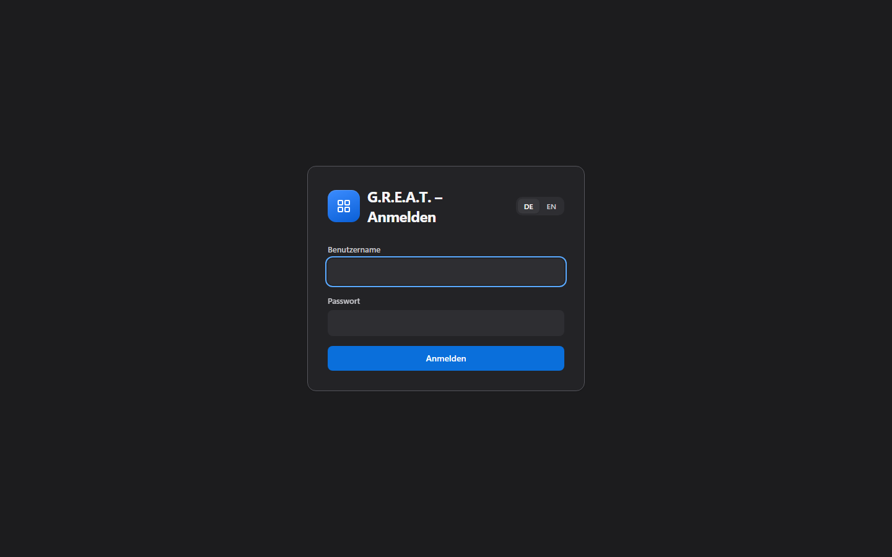

G.R.E.A.T. starts with a login page. Enter your username and password.

| Field | Description |
|------|-------------|
| **Username** | The username assigned to you by the admin |
| **Password** | Your personal password |

If you enter incorrect credentials, an error message appears. After three failed attempts, the account is locked for a short time.

### 1.2 First start & default password

The very first time the system starts, the login page shows the **default password** of the admin account. This is a deliberate trade-off between simplicity and security:

- The default admin user is called `admin`
- The default password is shown once on the login page
- After your first login you **must** change the password (see 1.3)

> **Note:** Copy the default password into a password manager right away. Once you leave the login page, you can no longer see it.

### 1.3 Changing your password

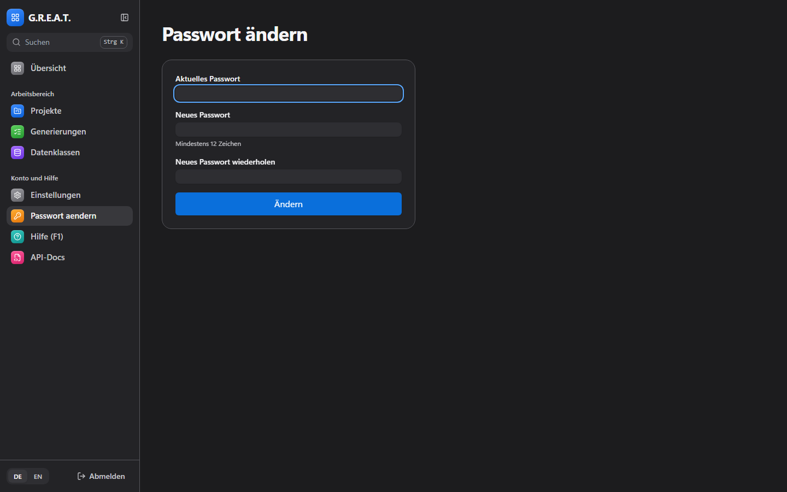

After your first login you are automatically redirected to the password change page. You can also change your password later via **"Change Password"** in the sidebar.

**Requirements for the new password:**

| Criterion | Minimum |
|-----------|---------|
| Length | 12 characters |
| Uppercase letters | at least 1 |
| Lowercase letters | at least 1 |
| Digits | at least 1 |
| Special characters | at least 1 |

> **Warning:** You cannot reuse the old default password as your new password (`password_is_default`).

### 1.4 Project overview

After logging in, you see the **sidebar** on the left (Overview, Projects, Generations, Data Classes, Settings, Help). Under **Projects** you find all projects you have access to. The search field at the top of the sidebar (Ctrl+K) filters the project list by name.

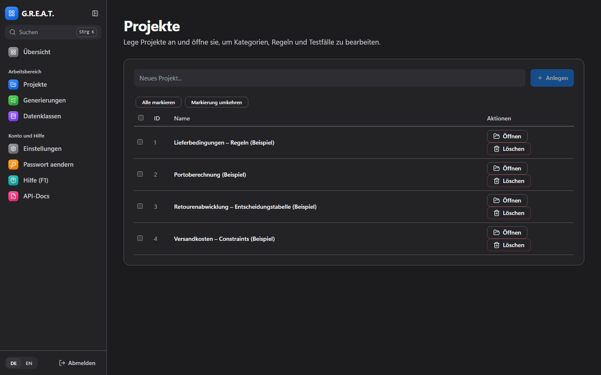

| Action | Description |
|--------|-------------|
| **New project** | Creates a new, empty project |
| **Delete project** | Removes a project permanently (with confirmation) |
| **Bulk delete** | Deletes several projects at once |
| **Reset database** | Restores the initial configuration (all data is lost) |

### 1.5 Example projects

On first start and after resetting the database, G.R.E.A.T. creates four example projects. They show the most important techniques using one common theme (shipping in an online shop):

| Example project | Shows |
|-----------------|-------|
| **Portoberechnung (Beispiel)** (postage calculation) | Categories, values, risk weights and a result category (`Portopreis`) whose value you enter for each test case as the expected result |
| **Lieferbedingungen – Regeln (Beispiel)** (delivery terms – rules) | Five classic rules of all three types: Dependent, Forbidden, Combine (chapter 5) |
| **Versandkosten – Constraints (Beispiel)** (shipping costs – constraints) | Five logical constraints with AND/OR/NOT, "is one of" (IN) and if-then (chapter 5.7) |
| **Retourenabwicklung – Entscheidungstabelle (Beispiel)** (returns handling – decision table) | Three causes and three effects; **"Generate rules"** in the Decision Table tab produces 2³ = 8 rules (chapter 4) |

You can edit or delete the examples. Deleted examples only come back after you reset the database. The examples are also available as model files in the `examples/` folder (chapter 2.4).

---

## 2. Managing Projects

### 2.1 Creating a project

Under **Projects**, enter a name in the "New project..." field and click **"Create"**. The project is empty at first.

### 2.2 Deleting a project

In the project list, **"Delete"** deletes a single project; to delete several at once, select them with the checkboxes and click **"Delete"** in the selection bar. A confirmation prevents accidental deletion.

> **Caution:** All categories, values, rules and generated test cases of the project are permanently lost.

### 2.3 Resetting the database

In **Settings** you find the **"Reset database"** button. It deletes all projects, generations and your own data classes and recreates the example projects (1.5). User accounts are kept.

> **Warning:** This action cannot be undone. Back up important data first (see 10.3).

### 2.4 Exporting and importing a model as a file

You can save a test model (categories, values, rules, constraints, seed sets) as a readable file, for example to put it under version control or to pass it on:

- **Export model** (header of the project view): YAML (default) or JSON. Generations, users and IDs are not included; references use names.
- **Import model**: as a new project or to update an existing project. Before an update, a preview shows what will be added, changed or removed. Existing generations remain unchanged.

The file is checked on import: required field `schemaVersion` (number), no unknown keys, unique category names (case-insensitive). Constraints whose categories or values are missing are imported as "invalid" and reported. Examples are in the `examples/` folder.

---

## 3. Categories & Values

Categories are the building blocks of a test project. Each category corresponds to a test parameter (e.g. "Operating system", "Browser", "Database").

### 3.1 Creating categories

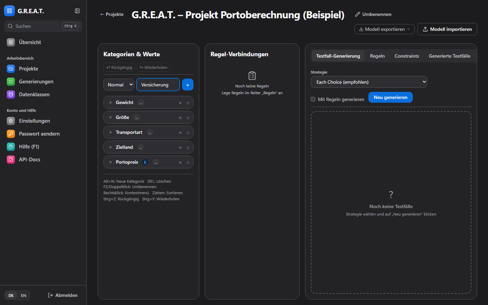

1. Open a project
2. In the left area (category tree) you see the input field **"Enter new category..."**
3. Enter the name and press Enter
4. The category appears in the tree

**Category types when creating:**

| Type | Meaning | Symbol |
|-----|-----------|--------|
| **Normal** | Standard category | — |
| **Cause** | Cause in cause-effect diagrams | U |
| **Effect** | Effect in cause-effect diagrams | W |
| **Result** | Not part of generation, entered manually | E |

### 3.2 Renaming & deleting categories

| Action | How |
|--------|-----|
| **Rename** | Right-click → "Rename (F2)" or **F2** on the selected category |
| **Delete** | Right-click → "Delete" (with confirmation) |
| **Change type** | Right-click → "Type: Normal/Cause/Effect" |

### 3.3 Category types in detail

**Result categories (`is_result=True`):**
- Are **not** used in automatic test case generation
- Can be filled in manually in the test case table after generation
- Recognizable by the **E** badge in the category tree

### 3.4 Managing values

Each category can contain any number of values. Values represent the possible input values for a test parameter.

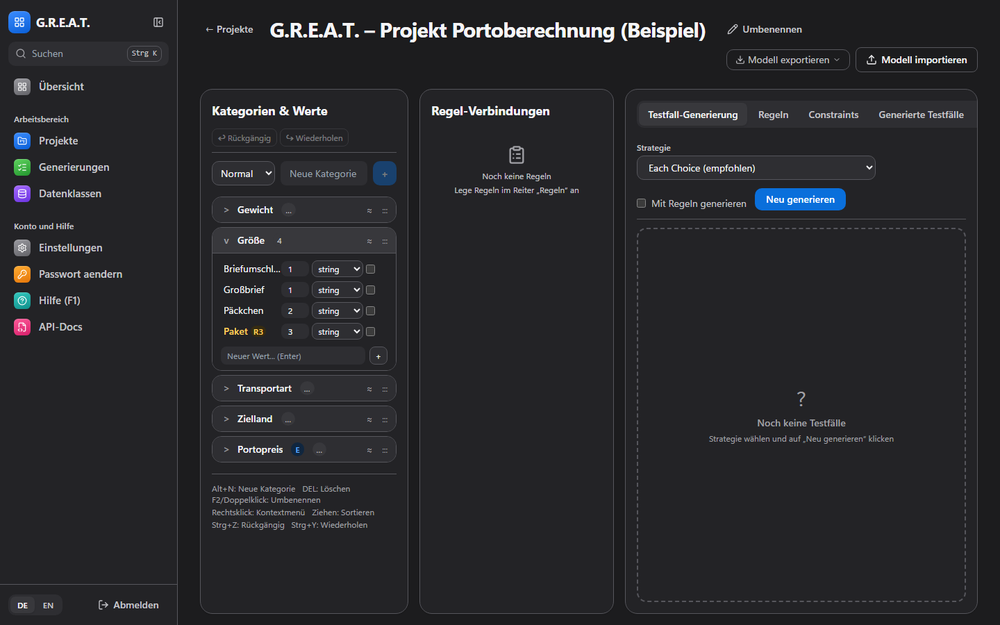

| Action | How |
|--------|-----|
| **Add value** | Click "+" next to the category |
| **Rename value** | Right-click → "Rename (F2)" or **F2** |
| **Delete value** | Right-click → "Delete" |
| **Sort values** | Drag & drop in the value list |

**Value counter:** A badge to the right of each category shows the number of values. If the category has not been opened yet, "…" appears; click it to load the values.

### 3.5 Marking error values

Error values (also called "invalid values") are inputs that are **not allowed** and that the system should reject. They are important for negative tests.

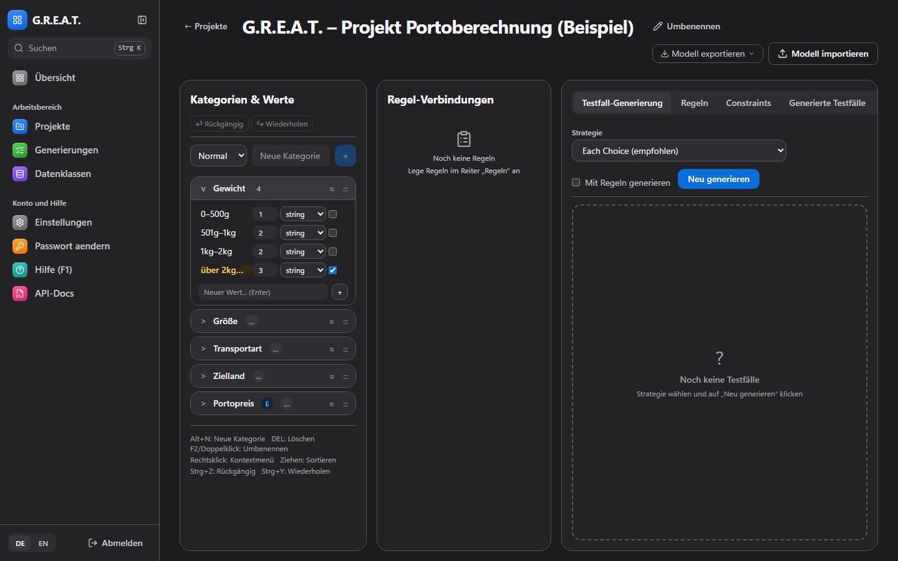

**Marking a value as an error value:**
1. Right-click the value
2. Click **"Mark as error value"**
3. The value is marked with a **✕** symbol (red)

**Behavior during generation:**
- Error values are included in test case generation
- Test cases with error values are sorted **to the end of the list**
- Exports contain an "Error Value" column (YES/NO)

### 3.6 Default value (linear expansion)

The **"Linear expansion"** strategy needs a **default value** for each category. This value is used in all test cases except the test case that tests the current value.

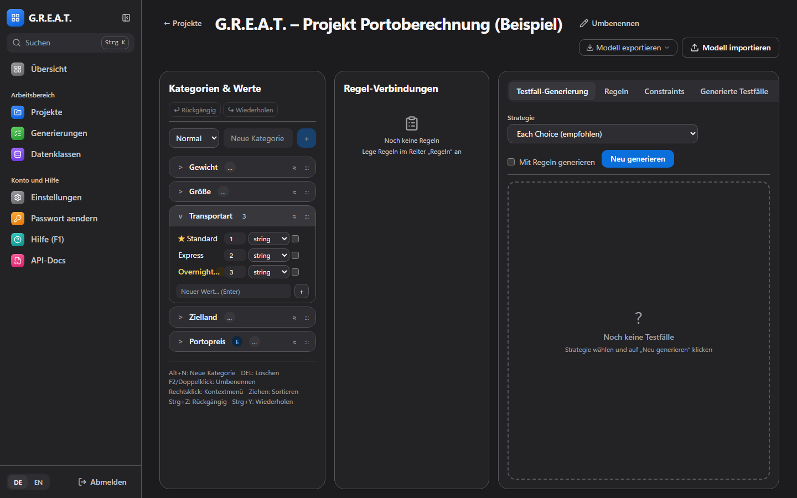

**Setting the default value:**
1. Right-click the value
2. Click **"★ Mark as default"**
3. The value is marked with a **★** symbol (gold)

**Removing the default value:**
1. Right-click the default value
2. Click **"✕ Remove default"**

> **Important:** Each category can have only **one** default value. If you set a new default, the old one is removed automatically.

**Symbol overview:**

| Symbol | Meaning | Color |
|--------|-----------|-------|
| ★ | Default value (linear expansion) | Gold/amber |
| ✕ | Error value (not allowed) | Red |
| R1–R10 | Risk weight | Orange |

### 3.7 Risk weight

Each value can have a **risk weight** (1–10). Higher weights mean higher risk and are prioritized by risk-based strategies.

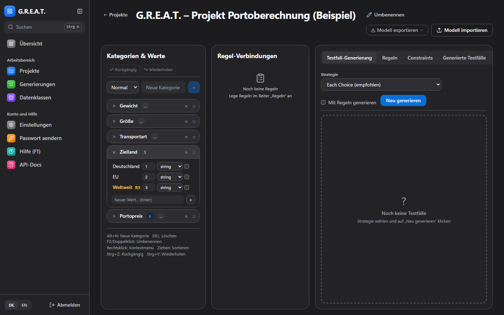

**Setting it:**
- A small input field appears in the value list (default: 1)
- Right-click the value → change the risk
- Values with risk > 2 are marked with an **R{n}** badge

### 3.8 Drag & drop sorting

You can sort categories and values by **drag & drop**:

- **Categories:** Drag a category up or down in the tree
- **Values:** Drag a value to a new position in the value list

The order determines the order in generated test cases and exports.

### 3.9 BVA (boundary value analysis)

**Boundary value analysis (BVA)** automatically generates test values at the boundaries of value ranges. It is integrated directly into category management.

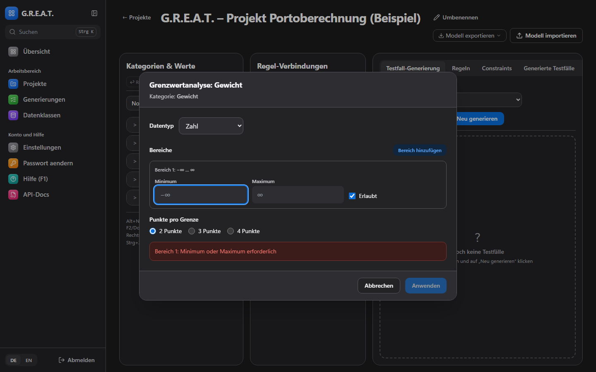

**Getting started:**
1. Right-click a category and choose **"Boundary Value Analysis..."**, or click the **BVA symbol** (↗↘) next to the category
2. The BVA dialog opens

**Simple BVA (one range):**
| Field | Description |
|------|-------------|
| **Minimum** | Lower limit of the allowed range |
| **Maximum** | Upper limit of the allowed range |
| **Points per boundary** | 2, 3 or 4 values per boundary |

**Points per boundary:**
| Points | Generated values per boundary |
|--------|----------------------------|
| 2 | boundary, boundary+1 |
| 3 | boundary-1, boundary, boundary+1 |
| 4 | boundary-2, boundary-1, boundary, boundary+1 |

**Example (minimum=10, maximum=100, 3 points):**
| Position | Value | Type |
|----------|-----|-----|
| Below | 9 | Error value (✕) |
| Lower boundary | 10 | Valid |
| Inside | 11 | Valid |
| Inside | 99 | Valid |
| Upper boundary | 100 | Valid |
| Above | 101 | Error value (✕) |

**Multi-range BVA (several ranges):**
For complex scenarios with several allowed/forbidden ranges:
1. Switch to **"Multiple ranges"** in the BVA dialog
2. Define minimum, maximum and allowed/forbidden status for each range
3. BVA generates values at all boundaries of all ranges

**Result:**
- Valid values are created as normal values
- Invalid values (outside the ranges) are automatically marked as **error values** (✕)
- The values appear in the category and can be used for generation right away

---

### 3.10 Classification tree

The **Classification tree** tab shows the test model as a tree according to the classification tree method: the root, below it the categories (classifications), and below those their values (classes). Below the tree is the test case matrix with one column per class; a dot (●) marks the class that the test case uses.

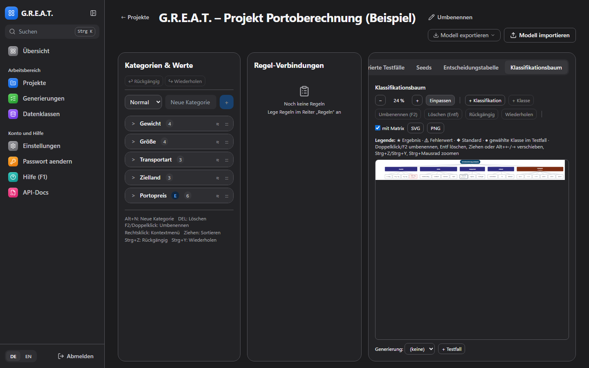

| Action | How |
|--------|-----------|
| Add a classification or class | "+ Classification" or "+ Class" |
| Rename | Double-click or F2 |
| Delete | Del (with confirmation) |
| Change order | Drag or Alt+arrow key |
| Undo / Redo | Ctrl+Z / Ctrl+Y |
| Zoom | Ctrl+mouse wheel, "+" and "−", "Fit" |
| Create a manual test case | "+ Test case", then click one class per classification; rule violations are marked immediately |
| Export | SVG or PNG, optionally "with matrix" |

Symbols: ★ result category, ⚠ error value, ◆ default value. You can save manually created test cases as a seed set (6.10).

---

## 4. Decision Table

The **decision table** (cause-effect table) is a systematic test design technique according to ISTQB. It models the logical relationships between **causes** (inputs) and **effects** (results) and generates minimal, complete test sets from them.

### 4.1 Overview & getting started

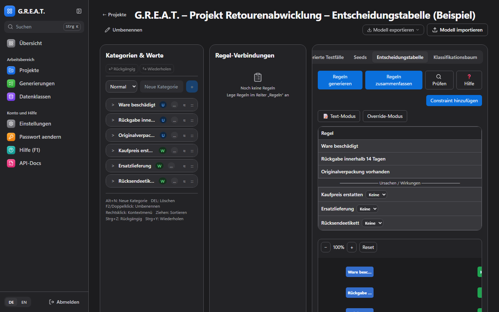

**Getting started:**
1. Open a project
2. Click the **"Decision Table"** button in the "Categories & Values" area
3. The decision table view opens in a new tab

**Important rule:**
- As soon as the decision table is active, the classic combinatorial strategies (All Combinations, Pairwise, etc.) are **grayed out**
- Generation is done exclusively via the decision table

### 4.2 Cause and effect categories

The decision table distinguishes two category types:

| Type | Symbol | Role | Position in the table |
|-----|--------|-------|---------------------|
| **Cause** | U | Input/condition | Upper half of the table |
| **Effect** | W | Result/effect | Lower half of the table |

**Assigning a category type:**
1. Right-click the category in the tree
2. Select **"Type: Cause"** or **"Type: Effect"**
3. The type is shown by the corresponding badge (U/W) in the tree

**Requirements:**
- At least **one cause** and **one effect** are required
- Normal categories and result categories are not used in the decision table
- You can change the type at any time later

### 4.3 Decision table view

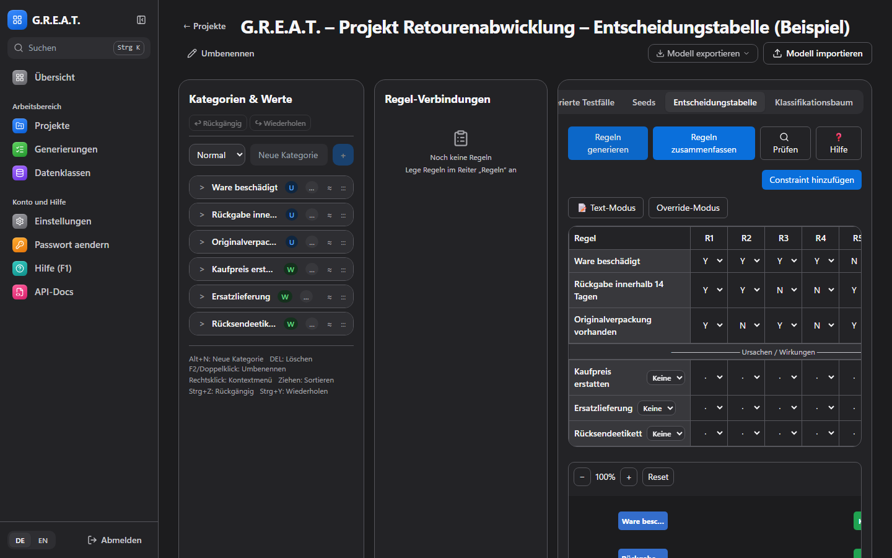

The table consists of three areas:

**Upper half — causes (conditions):**
| Column | Meaning |
|--------|-----------|
| Cause name | Category name of the cause |
| Yes/No/— | Value assignment for this rule (column) |

**Separator:** Visual separation between causes and effects

**Lower half — effects:**
| Column | Meaning |
|--------|-----------|
| Effect name | Category name of the effect |
| Yes/No/text/— | Result for this rule (column) |

**Right column — constraints:**
- Constraints per cause (E, O, I, R, M, see 4.5)

**Each vertical column** represents a **rule** (one test case).

### 4.4 Automatic rule generation

When you activate the decision table, G.R.E.A.T. **automatically** generates all valid combinations of the causes:

- With 2 causes: 2 × 2 = **4 rules** (Yes/Yes, Yes/No, No/Yes, No/No)
- With 3 causes: 2 × 2 × 2 = **8 rules**
- With n causes: **2^n rules**

**Procedure:**
1. The table is filled with all cause combinations
2. Effects are initially empty (—)
3. You fill in the effects manually or semi-automatically
4. G.R.E.A.T. automatically applies **collapsing** (see 4.7)

> **Note:** The number of rules is limited by the maximum test cases setting (default 1000).

### 4.5 Constraints (E, O, I, R, M)

**Constraints** define logical relationships between causes. They reduce the number of valid combinations and thus the number of test cases.

| Constraint | Abbreviation | Meaning | Example |
|------------|-----------|-----------|----------|
| **Exclusive** | E | At most one cause can be "Yes" | Only one format can be selected |
| **One-and-Only-One** | O | Exactly one cause must be "Yes" | Exactly one payment method must be chosen |
| **Inclusive** | I | At least one cause must be "Yes" | At least one contact option must be provided |
| **Requires** | R | If A="Yes", then B="Yes" | If "Premium", then "Login required" |
| **Mask** | M | If A="Yes", then B="No" | If "Free", then "Premium=No" |

**Usage:**
- Constraints are defined per cause
- Several causes can belong to the same constraint (group)
- During rule generation, invalid combinations are removed automatically

### 4.6 Constraint dialog

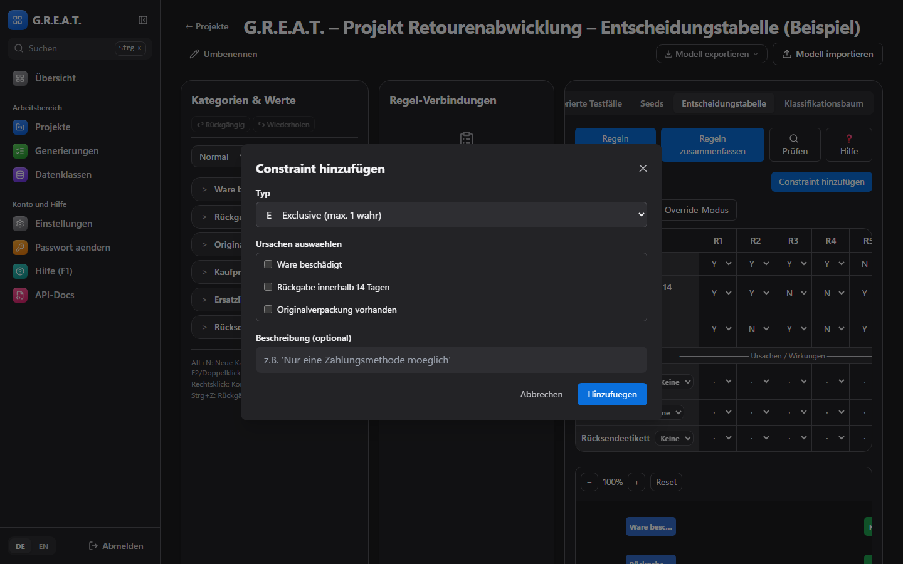

**Opening it:**
1. Right-click a cause in the table
2. Select **"Add constraint"**
3. The constraint dialog opens

**In the dialog:**
1. Select the **constraint type** (E, O, I, R, M)
2. Mark the **affected causes** (multiple selection possible)
3. For **Requires (R)**: assign cause A (trigger) and cause B (requirement)
4. For **Mask (M)**: assign cause A (trigger) and cause B (blocked)
5. **"Apply"** → the constraint is saved and shown in the table

**Display in the table:**
- Constraints appear as a badge next to the cause (e.g. "E" in red)
- Hovering over the badge shows details (involved causes)

### 4.7 Collapsing (automatic reduction)

**Collapsing** reduces the number of rules by merging rules with identical effect behavior.

**Principle:**
- If two rules have the same effects, they are merged into one rule
- The cause that differs between the two rules becomes **"—" (don't care)**

**Example (before collapsing):**

| | Rule 1 | Rule 2 |
|---|---------|---------|
| Cause A | Yes | No |
| Cause B | Yes | Yes |
| Effect X | Yes | Yes |

**After collapsing:**

| | Rule 1+2 |
|---|---------|
| Cause A | — (don't care) |
| Cause B | Yes |
| Effect X | Yes |

**Result:**
- The number of rules (test cases) is reduced
- Completeness is preserved
- Collapsing is applied automatically after every change

### 4.8 Don't care (—)

**"—" (don't care / irrelevant)** means: "The value of this cause does not matter for this rule."

**Created by:**
- Collapsing (automatic, see 4.7)
- Manual entry (right-click a cell → **"Set don't care"**)

**During generation:**
- Don't care means: "Both values (Yes and No) are possible"
- **Two test cases** are generated from it (one with Yes, one with No)
- This ensures that no combination is missed

**Example:**
| Cause A | Cause B | Effect |
|-----------|-----------|---------|
| — | Yes | X=Yes |

→ Generates: (A=Yes, B=Yes → X=Yes) **and** (A=No, B=Yes → X=Yes)

### 4.9 Extended entry (multiple values per cause)

Classic decision tables use only **Yes/No** (binary). G.R.E.A.T. supports **extended entry**: multiple values per cause in one rule.

**Usage:**
- Right-click a cell → select a value from the value list
- Not limited to Yes/No — all values of the category can be used

**Advantages:**
- More realistic modeling (not everything is binary)
- Fewer rules in complex scenarios

**Example:**
| Browser | OS | Effect |
|---------|-----|---------|
| Chrome | Windows | Compatible |
| Firefox | Linux | Compatible |
| IE | — | Incompatible |

### 4.10 Effects as text

Besides binary effects (Yes/No), you can define effects as **free text**.

**Setting it:**
- Right-click the effect category → activate **"Effects as text"**
- From now on you can enter any text values in the table

**Example:**
| Cause: Login | Effect: Message |
|---------------|-------------------|
| Yes | "Welcome" |
| No | "Please log in" |

**Advantages:**
- The expected test results directly as text
- Better traceability of the test cases

### 4.11 Checksum validation

**Checksum validation** checks whether the table is consistent:

**Checks:**
- Each rule has a unique combination of cause values
- No two rules have identical cause values (duplicate)
- All effects are defined for every rule (or explicitly set to don't care)

**Display:**
- **Green:** The table is consistent ✓
- **Red:** Contradiction or gap detected ✕
- Hovering shows details about the error message

**Activation:**
- Click **"Check"** in the table toolbar

### 4.12 Contradiction detection

G.R.E.A.T. automatically detects **contradictions** in the decision table:

| Type | Description | Example |
|-----|-------------|----------|
| **Duplicate** | Two rules with the same causes | Rules 1 and 3 both have A=Yes, B=Yes |
| **Conflict** | Same causes, different effects | Rule 1: A=Yes → X=Yes; rule 2: A=Yes → X=No |
| **Impossible** | A constraint is violated | E constraint, but two causes are "Yes" |

**Display:**
- Affected cells/rules are **marked in red**
- A toast message describes the contradiction
- **"Show contradictions"** button in the toolbar

### 4.13 Completeness check (gaps)

The **completeness check** identifies **missing combinations** of causes:

**Principle:**
- All possible cause combinations are compared with the table
- Missing combinations are marked as **gaps**

**Display:**
- **Complete:** All combinations covered ✓
- **Gaps:** n combinations not covered (details expandable)

**Example:**
- 2 causes (A, B) → 4 possible combinations
- The table has only 3 rules → 1 gap
- Gap: "A=No, B=No" is not in the table

**Action:**
- **"Fill in gaps"** → missing rules are added automatically
- Or manually: add a new rule with the missing values

### 4.14 Cause-effect graph

The **cause-effect graph** visualizes the logical relationships between causes, constraints and effects as a graph/diagram.

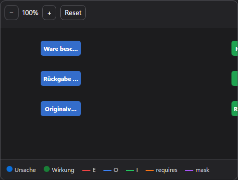

**Elements:**
| Symbol | Meaning |
|--------|-----------|
| Rectangle | Cause or effect |
| Arrow | Logical dependency |
| AND/OR/NOT | Logical operators |
| Constraint symbols | E, O, I, R, M |

**Navigation:**
- **Zoom:** Mouse wheel
- **Pan:** Click and drag
- **Details:** Hovering over a node shows a description

**Activation:**
- Click **"Show graph"** in the table toolbar
- The graph opens in a separate view next to the table

### 4.15 Generation from the decision table

Once the table is complete and free of contradictions, you can generate test cases:

**Procedure:**
1. Click the **"Generate rules"** button
2. G.R.E.A.T. creates one or more test cases per rule:
   - Don't care (—) → two test cases (Yes and No)
   - Extended entry → one test case per value combination
3. The test cases are shown in the generation view
4. Export as usual (CSV, JSON, Excel)

**Special notes:**
- Constraints are taken into account during generation
- Contradictions block generation (fix them first)
- Gaps may have occurred during generation (warning)

**Result:**
- Minimal, complete test set
- Every rule is covered
- Constraints are guaranteed

---

## 5. Rules (classic)

Rules define relationships between values of different categories. They reduce the test space to relevant combinations.

### 5.1 Rule types overview

| Type | Symbol | Meaning | Color |
|-----|--------|-----------|-------|
| **Forbidden** | ✕ | If A=X, then B!=Y | Red |
| **Dependent** (Dependency) | → | If A=X, then B=Y | Violet |
| **Combine** | ⊂ | If A=X, then B in [Y,Z,...] | Green |

### 5.2 Forbidden combinations (Forbidden)

A forbidden combination says: "If category A has value X, category B must **not** have value Y."

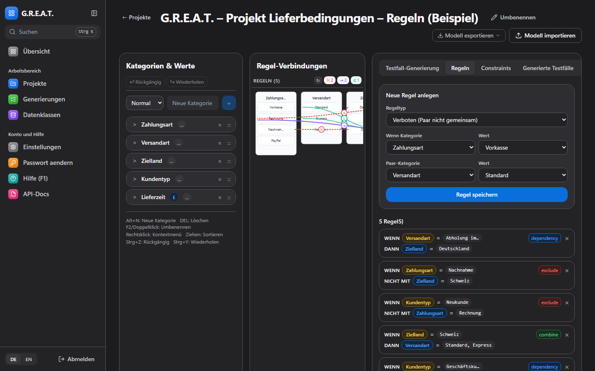

**Example:**
- If **Browser = Internet Explorer**, then **CSS feature != Grid Layout**
- This combination is automatically excluded during generation

**Creating it:**
1. In the rules area, click **"Forbidden rule"**
2. Select the if-category and the if-value
3. Select the then-category and the then-value
4. The rule is saved immediately

### 5.3 Dependencies (Dependency)

A dependency says: "If category A has value X, category B **must** have value Y."

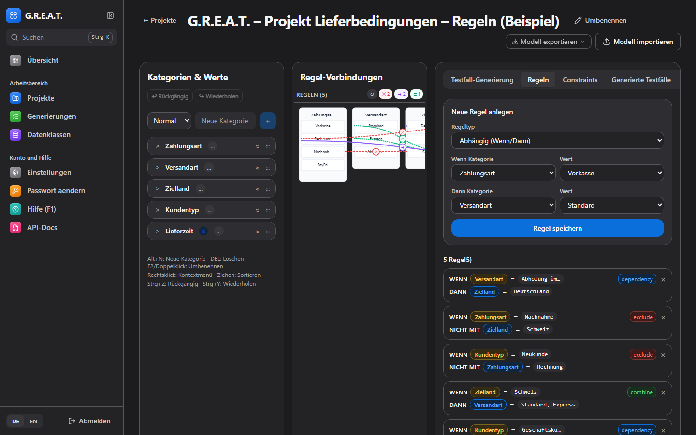

**Example:**
- If **Database = Oracle**, then **Driver = JDBC**
- This combination is enforced

### 5.4 Combine (Combine)

A combine rule says: "If category A has value X, category B may **only** have one of the values from the list [Y, Z, ...]."


**Example:**
- If **Operating system = Linux**, then **Web server in [Apache, Nginx]**
- Other web servers (IIS, Tomcat) are excluded for Linux

### 5.5 Rule visualization


G.R.E.A.T. shows rules as **SVG-based connecting lines** between the values of different categories:

| Rule type | Line style | Color |
|----------|-----------|-------|
| Forbidden | Dashed + ✕ | Red |
| Dependent | Solid + → | Violet |
| Combine | Dotted + ⊂ | Green |

**Interaction:**
- **Hover:** Hovering over a line shows a tooltip with the rule details
- **Refresh:** The ↻ button refreshes the visualization
- **Adjust height:** Drag the resize handle to enlarge or shrink the area

### 5.6 Detecting rule contradictions

G.R.E.A.T. automatically checks for contradictions between rules:

- **Duplicates:** The same rule already exists
- **Contradictions:** Two rules enforce opposing values
- **Dead values:** Because of the rules, a value can never appear in a test case

Warnings appear as toast messages when you create a rule.

---

### 5.7 Logical constraints (multiple conditions)

Classic rules connect exactly two categories. **Logical constraints** (**Constraints** tab) describe conditions across any number of categories:

| Kind | Meaning | Example from "Versandkosten – Constraints" |
|-----|-----------|---------------------------------------------|
| **Forbid** (forbid) | This combination must not occur in any test case | Versandart = Spedition **and** Gewicht = bis 2 kg |
| **Implication** (implies) | If the condition holds, the consequence must hold too | **If** Gewicht = ueber 10 kg, **then** Versandart = Spedition |

(In the example, Versandart = shipping method, Spedition = freight forwarder, Gewicht = weight, bis 2 kg = up to 2 kg, ueber 10 kg = over 10 kg.)

Building blocks of a condition:

- **equals (=) / not equals (!=)** a value
- **IN / NOT IN** a set of values (e.g. Zielland NOT IN Deutschland, EU – destination country is neither Germany nor EU)
- **AND group**, **OR group** for groups; **NOT** to negate a condition or group (up to 5 levels deep)

When you save, G.R.E.A.T. checks the constraint and lists values that can then no longer occur in any valid test case. If a category or value used by a constraint is about to be deleted, G.R.E.A.T. asks you first; affected constraints are marked as **invalid** and are not applied during generation until you edit them. Generation reports constraints that were not applied as a notice.

---

## 6. Test Case Generation

### 6.1 Generation strategies overview

| Strategy | Abbreviation | Description | When to use |
|-----------|-----------|-------------|----------------|
| **All Combinations** | All | Complete Cartesian product | Small projects, reference |
| **Pairwise** | Pair | Every pair of values at least once | Default, good coverage/effort ratio |
| **Orthogonal** | Orth | Orthogonal arrays | Evenly distributed categories |
| **Each Choice** | Each | Every value at least once | Minimal test set |
| **Linear Expansion** | Linear | One test per category, the rest on default | Low effort |
| **T-Wise** | T-Wise | T-wise combinations (t=2–5) | Configurable depth |
| **MC/DC** | MC/DC | Modified Condition/Decision Coverage | Safety-critical (DO-178C) |
| **Risk-Based** | Risk | Risk-weighted selection | Risk focus |
| **BVA** | BVA | Boundary value analysis | Numeric ranges |

### 6.2 All Combinations

Generates **all possible combinations** of all values of all categories.

**Formula:** `Number of test cases = W1 × W2 × ... × Wn` (W = values per category)

**Example:** 3 categories with 3 values each → 3 × 3 × 3 = **27 test cases**

> **Caution:** With many categories/values the number explodes quickly. Default limit: 1000 test cases per generation.

**Properties:**
- 100% combinatorial coverage
- Theoretical maximum for risk coverage
- Good as a reference for other strategies

### 6.3 Pairwise / Orthogonal

**Pairwise (all pairs):** Tests every **pair combination** of values at least once. With 3 categories of 3 values each: only about 9 test cases instead of 27.

**Orthogonal:** Based on **orthogonal arrays** (Sroka/Meyer algorithm). Produces minimal test sets with guaranteed pair coverage.

**When to use:**
- Pairwise defects are the most common (studies: 95%+ of defects are caused by interactions of 1–2 parameters)
- Good ratio of coverage to effort

### 6.4 Each Choice

Ensures that **every value** occurs in at least one test case. Produces the **smallest possible** test set.

**Example:** 3 categories with 3, 4 and 2 values → at least 4 test cases (determined by the largest category)

**When to use:**
- Quick overview
- Very large test spaces
- In combination with other strategies

### 6.5 Linear Expansion

**One test case** is created per category, in which the value of the current category varies and all other categories have their **default value**.

**Prerequisite:** Each category needs exactly one **default value** (marked with ★).

**Example:** 3 categories → 3 test cases

**When to use:**
- Minimal test effort
- Smoke tests
- Quick regression

### 6.6 T-Wise

Generalization of pairwise: tests all **t-wise combinations**. Default: t=2 (identical to pairwise). Configurable up to t=5.

**Rule of thumb:** Higher t → better coverage, but exponentially more test cases

**Setting it:** In the generation UI, you choose the **T strength** (2–5).

### 6.7 MC/DC

**Modified Condition/Decision Coverage** is a test criterion from aerospace (DO-178C). It ensures that each condition in a Boolean expression independently affects the outcome.

**When to use:**
- Safety-critical software (avionics, medical technology, automotive)
- Certification requirements (DO-178C, ISO 26262)

### 6.8 Risk-Based

Generates test cases based on the **risk weights** of the values. Values with a higher weight appear more often.

**Prerequisite:** Values should have risk weights (1–10). Default weight: 1.

**When to use:**
- Focus on high-risk areas
- Limited test time

### 6.9 Applying rules during generation

In the generation UI you find the **"Generate with rules"** option (checkbox). When it is enabled:

1. The rule engine is loaded before generation
2. Generated test cases are filtered by the rules
3. Forbidden combinations are removed
4. Dependencies are enforced
5. Combine rules restrict the allowed values

> **Note:** Rules can significantly reduce the number of generated test cases.

---

### 6.10 Mandatory test cases (seeds) and gap filling

**Seeds** are test cases that must be included in every generation, e.g. from bug reports or acceptance tests. In the **Seeds** tab you create seed sets, edit them or import them from a CSV file (column headers = category names). An empty field means "any": generation fills it with a suitable value; in the test case table such fields are shown in *italics*.

When generating, you choose a seed set. G.R.E.A.T. takes over all seeds and only adds the combinations of the chosen strength that are still missing. The test case limit never cuts seeds, only the added test cases (with a notice).

**Gap filling:** For an existing generation, **"Fill gaps"** creates a new generation that keeps the previous test cases and only adds missing combinations.

### 6.11 Coverage display

The generation overview shows the **2-wise coverage** in percent for each generation. The coverage matrix shows, for every pair of categories, how many possible value pairs are covered (heatmap). Combinations that are impossible because of rules or constraints do not count as "possible". You can display missing pairs as a list or CSV and add them with **"Fill gaps"**.

---

## 7. Risk Coverage

### 7.1 Risk coverage per test case

Each test case gets a **risk_coverage** value: the **sum of the risk weights** of all assigned values.

**Example:**
| Test case | Browser (R3) | OS (R5) | DB (R2) | risk_coverage |
|----------|-------------|---------|---------|--------------|
| TC_1 | Chrome | Linux | MySQL | 3 + 5 + 2 = **10** |
| TC_2 | Firefox | Windows | Oracle | 3 + 1 + 5 = **9** |

Test cases are sorted **in descending order of risk_coverage** (high risks first). Test cases with error values still go to the end.

### 7.2 Risk coverage percentage

**risk_coverage_percent** indicates how large the share of covered risks is compared with the theoretical maximum (All Combinations):

```
Percent = (sum of all risk_coverage / maximum for All Combinations) × 100
```

| Strategy | Typical value |
|-----------|---------------|
| All Combinations | 100% |
| Pairwise | 40–70% |
| Each Choice | 10–30% |
| Linear Expansion | 5–15% |

> **Note:** A low percentage does not mean poor quality — it only shows that fewer combinations are tested. Pairwise, for example, covers 95%+ of pairwise defects with only 30–50% risk coverage.

### 7.3 Risk summary

After generation, G.R.E.A.T. shows a **risk summary**:

| Metric | Meaning |
|----------|-----------|
| **total_risk** | Sum of all risk_coverage values |
| **max_possible_risk** | Theoretical maximum (All Combinations) |
| **risk_coverage_percent** | Share achieved in % |
| **testcase_count** | Number of generated test cases |

---

## 8. Export

### 8.1 CSV export

Exports test cases as a CSV file (semicolon-separated, UTF-8 with BOM for Excel compatibility).

**Columns:**
- One column per category
- `__TestCaseID`, `__GenerationID`, `__Strategy`
- `Status` (optional, with `?status=1`)
- `Error Value` (YES/NO; in German: `Fehlerwert`, JA/NEIN)

**URL parameters:**
| Parameter | Default | Description |
|-----------|---------|-------------|
| `encoding` | `utf-8-sig` | utf-8-sig, utf-8, cp1252, iso-8859-1, latin-1, utf-16le, utf-16be |
| `excel` | `true` | Adds `sep=;` as the first line |
| `bom` | auto | BOM on/off |
| `status` | `false` | Adds a rule status column |

> **Security:** Values that start with `=`, `+`, `-` or `@` are protected with an apostrophe in CSV exports so that Excel/LibreOffice does not execute them as formulas (formula injection protection).

### 8.2 JSON export

Exports test cases as structured JSON with a project, category and test case hierarchy.

**Structure:**
```json
{
  "generation_id": 1,
  "project_id": 1,
  "strategy": "all",
  "testcase_count": 27,
  "testcases": [
    {
      "name": "TC_1",
      "assignments": {"Browser": "Chrome", "OS": "Linux"},
      "has_error_value": false
    }
  ]
}
```

### 8.3 Excel export

Exports test cases as an `.xlsx` file (openpyxl). Same columns as CSV, but as a native Excel table with bold headers.

> **Security:** All text cells are marked as string type so that Excel does not interpret any values as formulas (formula injection protection). Numeric IDs (TC ID, generation ID) remain numbers.

### 8.4 Error value marking in exports

All export formats contain a column/field `Error Value` (German: `Fehlerwert`) or `has_error_value` that indicates with **YES/NO** (or `true/false`) whether the test case contains at least one error value.

In the test management formats, the marking is placed so that it survives the import; the origin (seed, gap filling) is shown there as well:

| Format | Error value | Origin |
|--------|-----------|----------|
| Xray (Jira) | `Labels` column: `error-value` | `Labels`: `seed` or `gap-fill` |
| TestRail | `Error Value` column: Yes/No | `Origin` column: generated, seed, supplemented |
| Azure DevOps | `Tags` column: `error-value` (first row of the test case) | `Tags`: `seed` or `gap-fill` |
| JSON (data-driven) | `has_error_value` | `origin` |

In the "JSON (data-driven)" format, `id`, `has_error_value` and `origin` keep their meaning; a category with one of these names appears as `id (2)` and so on.

### 8.5 Language and long values in exports

- Column headers follow the language of the user interface. Via the API, `?lang=de|en` selects the language; if it is not given, the `Accept-Language` header applies, otherwise German.
- G.R.E.A.T. stores very long values from boundary value analysis (string length over 500 characters) as placeholders, e.g. `<STR len=1001 charset=alnum>`. When the test cases are exported, the placeholder becomes a real string of the given length; the same placeholder always produces the same string. In the user interface and in the model file, the placeholder stays as it is.

---

## 9. Data Classes

### 9.1 System data classes

G.R.E.A.T. provides predefined data classes (equivalence classes) for common test parameters:

| Data class | Values |
|-------------|-------|
| **Browser** | Chrome, Firefox, Safari, Edge, IE |
| **Operating system** | Windows, Linux, macOS, iOS, Android |
| **Database** | MySQL, PostgreSQL, Oracle, SQL Server, SQLite |
| **Web server** | Apache, Nginx, IIS, Tomcat |
| **Resolution** | 800×600, 1024×768, 1920×1080, 2560×1440 |
| **Language** | German, English, French, Spanish |

### 9.2 Your own data classes

Create your own data classes in the **Data Classes** view (`/dataclasses`). A data class is a named set of values that you can reuse in several projects.

### 9.3 Using data classes in projects

When you create a category, you can use an existing data class as a template (**"Apply data class..."** in the category's context menu). All values of the data class are automatically created as values of the category.

---

## 10. Settings

### 10.1 Appearance (themes)

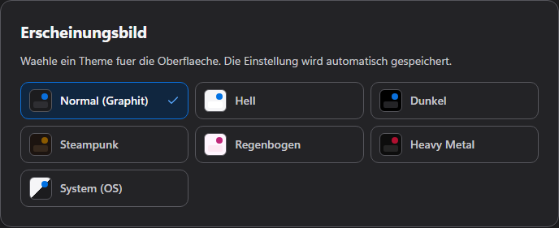

G.R.E.A.T. supports several themes. All of them share the same design (sidebar, cards, icon tiles) and are easy to read in all menus and dialogs (contrast according to WCAG AA, checked automatically):

| Theme | Description |
|-------|-------------|
| **Normal (graphite)** | Default: dark graphite background, light text, blue accent |
| **Light** | Light background, white cards, dark text, blue accent |
| **Dark** | Deep black background, blue accent |
| **Steampunk** | Brown/gold in a steampunk style |
| **Rainbow** | Light theme with pink/purple accents |
| **Heavy Metal** | Black/red |
| **System (OS)** | Follows the operating system setting: Light in light mode, Dark in dark mode |

Your choice is saved automatically in the browser (localStorage).

**System (OS):** Uses the `prefers-color-scheme` setting of the browser/operating system. If the system setting changes, G.R.E.A.T. adapts automatically.

### 10.2 Maximum number of test cases

By default, at most **1000 test cases** are created per generation. This prevents an unintended explosion of resources with large test spaces.

**Configuration:**
- Visible and changeable as the **"Maximum Number of Test Cases"** card in Settings
- Backend: environment variable `GREAT_MAX_TESTCASES`
- An explicit `limit` parameter in the generation request overrides this value

### 10.3 Data backup

In Settings you find the **Data Backup** option. It creates a JSON export of all projects, categories, values, rules and test cases.

**Backup options:**
- **Unencrypted:** Download without a password (fast, for local backups)
- **Encrypted:** Enter a password for AES-128 encryption (recommended for external storage)

**What is backed up:**
- All projects, categories, values (incl. risk weights, default markings, error values)
- All rules (dependencies, forbidden combinations, combine rules)
- All generations and test cases
- User-defined data classes
- Hierarchical data nodes
- Decision table constraints

**What is NOT backed up:**
- **Users and passwords:** For security reasons, no user data or passwords are backed up. After restoring, you must log in with existing accounts.
- **System data classes:** Predefined system data classes (Browser, Operating system, etc.) are not backed up. They are recreated automatically on the next start.
- **System data nodes:** Predefined system data nodes are not backed up.

> **Tip:** Always create a backup before resetting the database (see 2.3).
> **Note:** Encrypted backups can only be restored with the correct password. If you lose the password, the data cannot be recovered.

---

## 11. Users & Roles

### 11.1 Roles

| Role | Permissions |
|-------|---------------|
| **Admin** | Everything: manage users, create/delete projects, reset the database |
| **Editor** | Edit projects, create categories/values/rules, generate, export |
| **Viewer** | Read only: view projects, export test cases |

### 11.2 Project sharing

Admins and project owners can share projects with other users. The user the project is shared with gets access according to their role.

### 11.3 Managing users

In Settings (**User Management**), admins can create new users, assign roles, and edit or deactivate existing users.

---

## 12. Keyboard Navigation & Shortcuts

| Key combination | Action |
|------------------|--------|
| **F1** | Open/close help |
| **Ctrl+K** | Search in the sidebar (filter projects by name) |
| **F2** | Rename the selected element |
| **Enter** | Confirm / expand category |
| **Escape** | Close / cancel |
| **Right-click** | Open the context menu |
| **Tab** | Move between elements |
| **Arrow keys** | Navigate in tables and trees |

---

## 13. Glossary

| Term | Definition |
|---------|-----------|
| **Equivalence class** | Set of input values that the system treats the same way (ISTQB) |
| **All Combinations** | Complete Cartesian product of all values |
| **Boundary value analysis (BVA)** | Test technique that examines the boundaries of value ranges |
| **Default value** | Standard value for linear expansion; exactly one per category |
| **Error value** | Value with `allowed=False`; represents invalid input |
| **Category** | Test parameter; contains a set of possible values |
| **Combinatorial testing** | Test technique that systematically examines combinations of input parameters |
| **Linear expansion** | Generation strategy: one test case per category, the others on default |
| **MC/DC** | Modified Condition/Decision Coverage; test criterion for safety-critical software |
| **Orthogonal array** | Mathematical structure for minimal test sets with pair coverage |
| **Pairwise testing** | Testing all possible pairs of values (T=2) |
| **Risk weight** | Value 1–10 per value; higher = riskier |
| **Risk-based testing** | Test strategy that focuses on high-risk areas |
| **Test case** | A concrete combination of values of all categories |
| **T-Wise** | Generalization of pairwise to t-wise combinations |
| **Value** | Possible input for a category |

---

## 14. Frequently Asked Questions (FAQ)

**Why don't more than 1000 test cases appear with All Combinations?**
By default, a limit of 1000 test cases per generation applies. Change it in Settings or pass an explicit `limit` parameter.

**Why is my risk coverage only 30% with Pairwise?**
That is normal. Pairwise tests only ~30–50% of all possible combinations, but covers >95% of pairwise defects. The percentage refers to the All Combinations maximum.

**How do I remove a default value?**
Right-click the value with the ★ symbol → "✕ Remove default".

**Can I still change values after generation?**
No. The generated test cases are fixed. Change the values before generation or create a new generation.

**What does the ✕ symbol on a value mean?**
The value is marked as an error value (`allowed=False`). Test cases with this value are sorted to the end and marked as "Error Value: YES" in exports.

**Why don't result categories appear in generated test cases?**
Result categories (`is_result=True`) are not part of automatic generation. They are used to enter expected values manually after generation.

**How do I change the default password?**
After your first login, you are automatically redirected to the password change page. Later: sidebar → "Change Password".

---

## 15. API Integration (for Developers)

G.R.E.A.T. offers a **RESTful API** with OpenAPI documentation that lets you integrate the program into other tools and processes (e.g. CI/CD pipelines, test management systems, your own scripts).

### 15.1 Basics

| Property | Value |
|-------------|------|
| **Base URL** | `http://localhost:8000/api/v1` (recommended; `/api/...` remains as an equivalent alias) |
| **Login** | `/auth/*` (without `/api`) |
| **OpenAPI docs** | `http://localhost:8000/docs` (Swagger UI), `http://localhost:8000/redoc` |
| **Authentication** | API token (`Authorization: Bearer great_pat_...`) for scripts and CI; session cookie in the user interface |
| **Content-Type** | `application/json` |
| **Message language** | Header `Accept-Language: de` or `en` |

The paths in 15.3 are relative to the base URL, e.g. `/projects` = `http://localhost:8000/api/v1/projects`.

### 15.2 Authentication

**Recommended for scripts and CI: API tokens.** Under **Settings → API Tokens** you create a token (name, expiry date, scopes). The plain-text token is shown **only once**; store it as a secret in your CI (e.g. `GREAT_TOKEN`).

| Permission (scope) | Allows |
|----------------------|---------|
| `projects:read` | Read projects, categories, generations |
| `projects:write` | Change projects and models |
| `generate` | Generate test cases, fill gaps |
| `export` | Export test cases |
| `models:read` / `models:write` | Export / import model files |

The intersection of the token owner's role and the scopes always applies. If a scope is missing, the API responds with 403 `insufficient_scope`. Tokens cannot be used for user management, password changes, token management, or backup/restore. Technical users (role `api_user`) cannot log in to the user interface; an admin creates their tokens.

```bash
export GREAT_URL=http://localhost:8000
export GREAT_TOKEN=great_pat_...   # from Settings → API Tokens

curl -H "Authorization: Bearer $GREAT_TOKEN" "$GREAT_URL/api/v1/projects"
```

**Alternative: login with username and password** (session cookie, e.g. for quick experiments):

```bash
curl -X POST "$GREAT_URL/auth/login" -d "username=admin&password=IHR-PASSWORT" -c cookies.txt
curl -b cookies.txt "$GREAT_URL/auth/me"
```

> **Note:** Never put the password in the URL. Requests with `?password=` are rejected; in the access log such values only appear as `***`.

### 15.3 API endpoints by category

#### Authentication (`/auth/*`)

| Method | Endpoint | Description | Role |
|---------|----------|-------------|-------|
| `POST` | `/auth/login` | Log in with username/password | — |
| `POST` | `/auth/logout` | Log out, invalidate tokens | — |
| `POST` | `/auth/refresh` | Renew the access token | — |
| `GET` | `/auth/me` | Your own user info | All |
| `POST` | `/auth/change-password` | Change password | All |
| `GET` | `/auth/first-start-hint` | Show the first-start hint | — |

#### Projects (`/projects/*`)

| Method | Endpoint | Description | Role |
|---------|----------|-------------|-------|
| `GET` | `/projects` | List all projects | All |
| `POST` | `/projects` | Create a new project | Writer |
| `GET` | `/projects/{pid}/categories` | Categories of a project | All |
| `POST` | `/projects/{pid}/categories` | Create a category | Writer |
| `DELETE` | `/categories/{cid}` | Delete a category | Writer |
| `PATCH` | `/categories/{cid}/rename` | Rename a category | Writer |
| `PATCH` | `/categories/{cid}/properties` | Change category properties | Writer |
| `PATCH` | `/projects/{pid}/categories/reorder` | Sort categories | Writer |
| `DELETE` | `/projects/{pid}` | Delete a project | Writer |
| `PUT` | `/projects/{pid}` | Update a project | Writer |
| `POST` | `/projects/bulk-delete` | Delete several projects | Writer |

#### Values (`/categories/{cid}/values/*`)

| Method | Endpoint | Description | Role |
|---------|----------|-------------|-------|
| `GET` | `/categories/{cid}/values` | Values of a category | All |
| `POST` | `/categories/{cid}/values` | Create a value | Writer |
| `DELETE` | `/values/{vid}` | Delete a value | Writer |
| `PATCH` | `/values/{vid}/rename` | Rename a value | Writer |
| `PATCH` | `/values/{vid}/properties` | Change value properties | Writer |
| `PATCH` | `/values/{vid}/set-default` | Mark as default value | Writer |
| `PATCH` | `/values/{vid}/unset-default` | Remove the default marking | Writer |
| `POST` | `/categories/{cid}/bva` | BVA for a category (boundary value analysis) | Writer |
| `POST` | `/categories/{cid}/bva/ranges` | BVA with several ranges | Writer |

#### Rules (`/projects/{pid}/rules/*`)

| Method | Endpoint | Description | Role |
|---------|----------|-------------|-------|
| `GET` | `/projects/{pid}/rules` | All rules of a project | All |
| `POST` | `/projects/{pid}/rules` | Create a new rule | Writer |
| `DELETE` | `/projects/{pid}/rules/{rid}` | Delete a rule | Writer |

**Rule types:** `forbidden`, `dependency`, `combine`

#### Generation (`/projects/{pid}/generate`, `/generations/*`)

| Method | Endpoint | Description | Role |
|---------|----------|-------------|-------|
| `POST` | `/projects/{pid}/generate` | Generate test cases | Writer |
| `POST` | `/projects/{pid}/generate?export=csv&persist=false` | Return test cases directly in an export format (csv, json, xlsx or a test management format); `persist=false` does not save a generation. With a token, the `export` scope is also required | Writer |
| `GET` | `/projects/{pid}/generations` | All generations of a project | All |
| `GET` | `/generations/{gid}/testcases` | Test cases of a generation | All |
| `PATCH` | `/testcases/{tcid}/assignments` | Change test case assignments | Writer |
| `DELETE` | `/generations/{gid}` | Delete a generation | Writer |
| `PATCH` | `/generations/{gid}/rename` | Rename a generation | Writer |

**Generation strategies:**
```json
{
  "strategy": "pairwise",
  "strength": 2,
  "limit": 1000
}
```

| Strategy | Description |
|-----------|-------------|
| `all` | Complete Cartesian product |
| `pairwise` | Pairwise testing (T=2) |
| `t_wise` | T-wise combinations |
| `each` | Each Choice |
| `linear` | Linear Expansion |
| `mcdc` | Modified Condition/Decision Coverage |
| `risk_based` | Risk-based testing |

#### Export (`/generations/{gid}/export/*`)

| Method | Endpoint | Description | Role |
|---------|----------|-------------|-------|
| `GET` | `/generations/{gid}/export/csv` | CSV export | All |
| `GET` | `/generations/{gid}/export/json` | JSON export | All |
| `GET` | `/generations/{gid}/export/xlsx` | Excel export | All |

#### Decision table (`/decision-table/*`)

| Method | Endpoint | Description | Role |
|---------|----------|-------------|-------|
| `POST` | `/decision-table/generate` | Generate rules from the decision table | Writer |
| `GET` | `/decision-table/categories/{project_id}` | Categories for the decision table | All |
| `GET` | `/decision-table/graph/{project_id}` | Cause-effect graph | All |
| `GET` | `/decision-table/constraints/{project_id}` | List constraints | All |
| `POST` | `/decision-table/constraints` | Create a constraint | Writer |
| `DELETE` | `/decision-table/constraints/{id}` | Delete a constraint | Writer |
| `POST` | `/decision-table/collapse` | Collapsing (reduction) | Writer |
| `POST` | `/decision-table/validate` | Validation (checksum, gaps) | Writer |

#### Data classes (`/dataclasses/*`)

| Method | Endpoint | Description | Role |
|---------|----------|-------------|-------|
| `GET` | `/dataclasses` | All data classes | All |
| `POST` | `/dataclasses` | New data class | Writer |
| `DELETE` | `/dataclasses/{dcid}` | Delete a data class | Writer |
| `PUT` | `/dataclasses/{dcid}` | Update a data class | Writer |
| `GET` | `/dataclasses/{dcid}/values` | Values of a data class | All |
| `POST` | `/dataclasses/{dcid}/values` | Create a value | Writer |
| `DELETE` | `/dataclasses/values/{vid}` | Delete a value | Writer |
| `PUT` | `/dataclasses/{dcid}/values/reorder` | Sort values | Writer |
| `POST` | `/categories/{cid}/apply-dataclass` | Apply a data class to a category | Writer |
| `GET` | `/dataclasses/export-user` | Export data classes | All |
| `POST` | `/dataclasses/import-user` | Import data classes | Writer |

#### Users & sharing (`/users/*`, `/project/*`)

| Method | Endpoint | Description | Role |
|---------|----------|-------------|-------|
| `GET` | `/users/` | All users | Admin |
| `POST` | `/users/` | Create a user | Admin |
| `PUT` | `/users/{user_id}` | Update a user | Admin |
| `DELETE` | `/users/{user_id}` | Delete a user | Admin |
| `GET` | `/project/{project_id}/members` | Project members | All |
| `POST` | `/project/{project_id}/members` | Add a member | Admin/Owner |

#### Miscellaneous

| Method | Endpoint | Description | Role |
|---------|----------|-------------|-------|
| `GET` | `/health` | Health check | — |
| `GET` | `/strategies` | Available generation strategies | — |
| `GET` | `/docs` | OpenAPI documentation (Swagger) | Admin/Editor or valid API token |
| `GET` | `/redoc` | ReDoc documentation | Admin/Editor or valid API token |

### 15.4 Roles and permissions

| Role | API access |
|-------|------------|
| **Admin** | Full access to all endpoints |
| **Editor** | Read and write access to projects, categories, values, rules, generation |
| **Viewer** | Read-only access (GET requests), export |
| **api_user** | Technical user for CI/test tools: no login to the user interface, access only via API token. An admin creates the token under Settings > API Tokens and selects the technical user as the owner. No mandatory password change. |

**Writer = Admin + Editor** (all endpoints that have `require_writer` as a dependency)

### 15.5 Example: complete workflow via the API

Create a project, add categories and values, generate and export (token with `projects:read`, `projects:write`, `generate`, `export`):

```bash
API="$GREAT_URL/api/v1"
AUTH="Authorization: Bearer $GREAT_TOKEN"

# 1. Create project (response contains "id")
curl -s -X POST "$API/projects" -H "$AUTH" -H "Content-Type: application/json" \
  -d '{"name":"Browser-Matrix"}'

# 2. Create category (response contains "id")
curl -s -X POST "$API/projects/1/categories" -H "$AUTH" -H "Content-Type: application/json" \
  -d '{"name":"Browser"}'

# 3. Add values
for v in Chrome Firefox Safari; do
  curl -s -X POST "$API/categories/1/values" -H "$AUTH" -H "Content-Type: application/json" \
    -d "{\"value\":\"$v\"}"
done

# 4. Generate and receive directly as CSV, without saving the generation
curl -s -X POST "$API/projects/1/generate?export=csv&persist=false" -H "$AUTH" \
  -H "Content-Type: application/json" -d '{"strategy":"pairwise"}' -o testfaelle.csv

# 5. Or: generate, save and export later in a test management format
GEN=$(curl -s -X POST "$API/projects/1/generate" -H "$AUTH" -H "Content-Type: application/json" \
  -d '{"strategy":"pairwise"}' | jq '.generation_id')
curl -s "$API/generations/$GEN/export/xray-csv" -H "$AUTH" -o xray.csv
```

To find a project by name: `GET /projects?name=Browser-Matrix` (exact match, case-insensitive).

### 15.6 Error handling

The API uses standard HTTP status codes:

| Code | Meaning |
|------|----------|
| `200` | Success |
| `201` | Created |
| `400` | Bad request (e.g. missing field) |
| `401` | Not authenticated |
| `403` | Not authorized |
| `404` | Not found |
| `409` | Conflict (e.g. duplicate name) |
| `422` | Validation error |
| `429` | Too many requests (rate limiting) |
| `500` | Internal server error |

Error responses contain a `detail` field with a description and, for fixed messages, a language-neutral `code` that scripts can react to:
```json
{"detail": "Projekt nicht gefunden", "code": "project_not_found"}
```
With `Accept-Language: en`, `detail` is in English (here: "Project not found"); the `code` stays the same.

### 15.7 Rate limiting

| Endpoint | Limit |
|----------|-------|
| `/auth/login` | 10 attempts/minute/IP |
| `/auth/change-password` | 10 attempts/minute/account |
| `/auth/first-start-hint` | 10 requests/minute/IP |
| API token | 600 requests/minute per token (`GREAT_TOKEN_RATE_LIMIT`) |

When the limit is exceeded: HTTP 429 with a `Retry-After` header.

### 15.8 OpenAPI specification

The complete OpenAPI specification (Swagger) is available at `http://localhost:8000/docs` (authentication required). There you can:

- Browse all endpoints
- Test requests directly in the browser
- View request/response schemas
- Download the OpenAPI specification as JSON/YAML (`/openapi.json`)

With **Authorize** you enter an API token (`great_pat_...`); all `/api` calls from the Swagger UI then send it as `Authorization: Bearer`. You can also retrieve `/openapi.json` with any valid API token.

> **Tip for CI/CD:** Download `/openapi.json` and use tools such as `openapi-generator` to generate client libraries in various programming languages.

---

*End of the user manual*

### 15.9 Integration into CI/CD

The examples create fresh test cases from a project on every run and store them as an artifact. To do this, store `GREAT_URL` and `GREAT_TOKEN` (token with `projects:read`, `generate`, `export`) as secrets.

**GitHub Actions**

```yaml
name: Testfaelle erzeugen
on: [workflow_dispatch]
jobs:
  testcases:
    runs-on: ubuntu-latest
    steps:
      - name: Projekt-ID suchen und Testfaelle exportieren
        env:
          GREAT_URL: ${{ secrets.GREAT_URL }}
          GREAT_TOKEN: ${{ secrets.GREAT_TOKEN }}
        run: |
          PID=$(curl -sf -H "Authorization: Bearer $GREAT_TOKEN" \
            "$GREAT_URL/api/v1/projects?name=Portoberechnung%20(Beispiel)" | jq '.[0].id')
          curl -sf -X POST -H "Authorization: Bearer $GREAT_TOKEN" -H "Content-Type: application/json" \
            "$GREAT_URL/api/v1/projects/$PID/generate?export=json-data-driven&persist=false" \
            -d '{"strategy":"pairwise"}' -o testcases.json
      - uses: actions/upload-artifact@v4
        with:
          name: testcases
          path: testcases.json
```

**GitLab CI**

```yaml
testcases:
  image: alpine:3.20
  script:
    - apk add --no-cache curl jq
    - PID=$(curl -sf -H "Authorization: Bearer $GREAT_TOKEN" "$GREAT_URL/api/v1/projects?name=Portoberechnung%20(Beispiel)" | jq '.[0].id')
    - >
      curl -sf -X POST -H "Authorization: Bearer $GREAT_TOKEN" -H "Content-Type: application/json"
      "$GREAT_URL/api/v1/projects/$PID/generate?export=gherkin&persist=false"
      -d '{"strategy":"pairwise"}' -o testcases.feature
  artifacts:
    paths: [testcases.feature]
```

**Jenkins (Declarative Pipeline)**

```groovy
pipeline {
  agent any
  environment {
    GREAT_URL   = 'http://great.intern:8000'
    GREAT_TOKEN = credentials('great-token')   // Secret text
  }
  stages {
    stage('Testfaelle') {
      steps {
        sh '''
          PID=$(curl -sf -H "Authorization: Bearer $GREAT_TOKEN" "$GREAT_URL/api/v1/projects?name=Portoberechnung%20(Beispiel)" | jq '.[0].id')
          curl -sf -X POST -H "Authorization: Bearer $GREAT_TOKEN" -H "Content-Type: application/json" \
            "$GREAT_URL/api/v1/projects/$PID/generate?export=robot&persist=false" \
            -d '{"strategy":"pairwise"}' -o testcases.robot
        '''
        archiveArtifacts artifacts: 'testcases.robot'
      }
    }
  }
}
```

Available formats for `export=`: `csv`, `json`, `xlsx`, `json-data-driven`, `gherkin`, `pytest`, `robot`, `markdown`, `xray-csv`, `testrail-csv`, `azuredevops-csv`.
